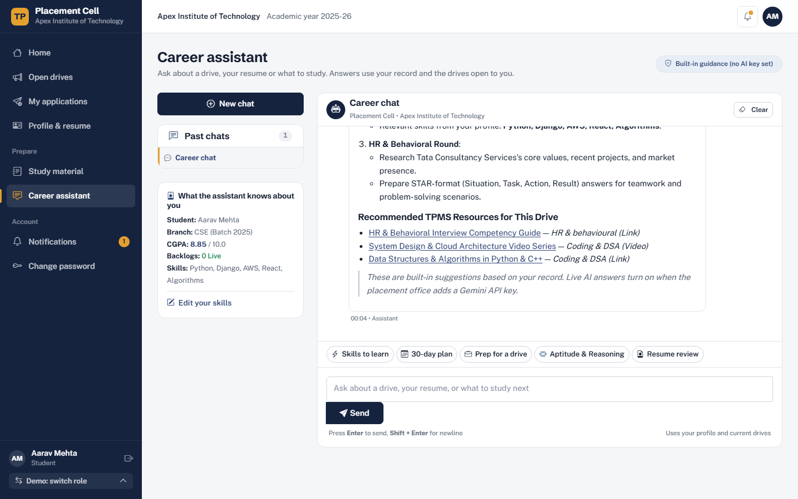
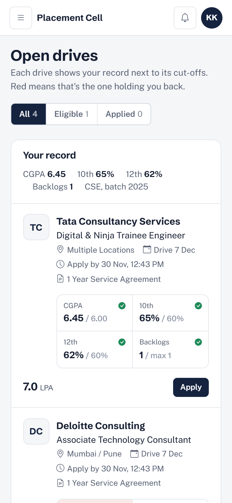

# Training & Placement Cell Portal (TPMS)

[](https://www.djangoproject.com/)
[](https://www.python.org/)
[](https://getbootstrap.com/)
[](tests/)
[](#design-system--offline-architecture)

A comprehensive, role-governed web platform engineered for higher educational institutions to digitize and manage end-to-end campus training and placement operations. The platform replaces fragmented departmental spreadsheets with a centralized database, strict departmental multi-tenancy, automated eligibility enforcement, multi-stage applicant tracking, accreditation analytics, and an integrated AI career mentorship assistant.


---

## Table of Contents

- [Core Capabilities](#core-capabilities)
- [Architecture & Design System](#architecture--design-system)
- [Quick Start](#quick-start)
- [Demo Accounts & Personas](#demo-accounts--personas)
- [Environment Configuration](#environment-configuration)
- [How a Campus Drive Works](#how-a-campus-drive-works)
- [Role-Based Portals](#role-based-portals)
- [Automated Eligibility Engine](#automated-eligibility-engine)
- [Bulk Student Ingestion](#bulk-student-ingestion)
- [AI Career & Placement Assistant](#ai-career--placement-assistant)
- [Security & Access Governance](#security--access-governance)
- [Project Layout](#project-layout)
- [Automated Testing Suite](#automated-testing-suite)
- [Visual Interface Gallery](#visual-interface-gallery)

---

## Core Capabilities

- **Strict Multi-Tenant Branch Isolation**: Department coordinators (TnP Assistants) are scoped exclusively to their assigned academic departments (CSE, IT, ECE, MECH, CIVIL) via ORM-level queryset filtering.
- **Automated Eligibility Engine**: Server-side programmatic validation cross-checks candidate academic records against drive cut-offs (CGPA, 10th %, 12th %, maximum active backlogs, eligible degree, and branch) with instant red/green indicator feedback.
- **Interactive Multi-Stage Selection Pipeline**: Structured round progression (`Applied` → `Shortlisted` → `Online Assessment` → `Technical Interview` → `HR Round` → `Offer Released` / `Rejected`) with live in-app notifications and automatic placement status sync.
- **Accreditation-Ready Executive Analytics**: Real-time visual dashboards powered by Chart.js displaying branch placement percentages, salary CTC distributions (Min/Avg/Max CTC), hiring velocity, and one-click CSV report exports for NAAC/NIRF reporting.
- **Dual-Mode AI Career Assistant**: Context-aware career mentorship subsystem powered by Google Gemini REST API (`gemini-flash-latest`) with an institutional rules-based guidance engine fallback when offline or without an API key.
- **Atomic Bulk Data Ingestion**: Robust parser supporting Excel (`.xlsx` via `openpyxl`) and CSV rosters with pre-validation error reporting, duplicate email/roll number suppression, and transactional rollbacks.
- **Protected Document Media**: Candidate resumes are served through a permission-checked streaming view (`students:download_resume`); direct public access to `/media/resumes/` is strictly prohibited.

---

## Architecture & Design System

- **Zero Client-Side Framework Overhead**: Server-rendered Django templates provide fast load times, predictable state, and clean separation of concerns without requiring Node.js, Webpack, or npm builds.
- **100% Offline Capability**: All vendor dependencies—Bootstrap 5.3 CSS/JS, Bootstrap Icons font assets, Chart.js, and typography files (Schibsted Grotesk and Public Sans WOFF2)—are bundled locally in `static/vendor/`. The entire platform runs without internet connectivity.
- **Ink Navy & Marigold Design Tokens**: Custom palette defined in `static/css/style.css` using deep ink navy (`#0B192C`, `#1E3E62`), warm marigold accent (`#FF9F43`, `#F39C12`), crisp white card surfaces (`#FFFFFF`), subtle slate borders (`#E2E8F0`), and high-contrast status badges.
- **Responsive Mobile Layout**: Navigation automatically transforms into an accessible off-canvas drawer on mobile screens, and multi-column cut-off matrices reflow into clean single-column cards.

---

## Quick Start

### Prerequisites
- Python 3.12+ (Python 3.10+ supported)
- SQLite3 (standard with Python)
- Modern web browser (Chrome, Edge, Firefox, Safari)

### Installation & Execution

```bash
# 1. Clone the repository
git clone https://github.com/Ayush7kr/tpms.git
cd tpms

# 2. Create and activate virtual environment
python -m venv venv
source venv/bin/activate          # Windows: venv\Scripts\activate

# 3. Install dependencies
pip install -r requirements.txt

# 4. Copy environment configuration
cp .env.example .env              # Windows: copy .env.example .env

# 5. Apply database migrations
python manage.py migrate

# 6. Seed demonstration dataset (populates realistic students, companies, drives, and relative deadlines)
python manage.py seed_tpms_data

# 7. Start development server
python manage.py runserver
```

Open [http://127.0.0.1:8000](http://127.0.0.1:8000) in your browser.

---

## Demo Accounts & Personas

When `DEMO_MODE=True` is enabled in `.env`, the sign-in page includes **single-click demo switcher buttons** that allow immediate evaluation of any role without entering passwords.

All accounts use the universal password `apex@123`:

| Role | Email | Name | Context & Responsibilities |
| :--- | :--- | :--- | :--- |
| **Student (Eligible)** | `aarav.mehta@apex.edu.in` | Aarav Mehta | CSE, CGPA 8.85, 0 backlogs. Meets cut-offs for all 4 campus drives; active applications in progress. |
| **Student (Placed)** | `rohan.sharma@apex.edu.in` | Rohan Sharma | CSE, CGPA 9.25. Holds official job offer from Google India (28.0 LPA). |
| **Student (Misses Cut-Offs)** | `karan.kapoor@apex.edu.in` | Karan Kapoor | CSE, CGPA 6.45, 1 live backlog. Demonstrates the cut-off engine highlighting missed criteria in red. |
| **Placement Officer (TPO)** | `tpo@apex.edu.in` | Prof. Arvind Deshmukh | Central corporate partnerships, drive creation/editing, company directory, and applicant stage movement. |
| **Department Coordinator** | `assistant.cse@apex.edu.in` | Sunil Patil | Manages CSE and IT student rosters, verifies candidate marks, and approves campus drives for assigned branches. |
| **Department Coordinator** | `assistant.ece@apex.edu.in` | Meena Nair | Scoped strictly to ECE candidates and ECE drive approvals. |
| **Principal** | `principal@apex.edu.in` | Dr. Ramesh Kulkarni | Macro-level institutional reports, branch placement percentages, salary bands, and CSV export. |
| **Administrator** | `admin@apex.edu.in` | Vikram Aditya | Master data governance, user provisioning, department creation, coordinator allocations, and audit logs. |

---

## Environment Configuration

Configuration is loaded from `.env` via `python-dotenv`. All settings include sensible defaults for local development:

| Variable | Default Value | Description |
| :--- | :--- | :--- |
| `DJANGO_SECRET_KEY` | `change-me-to-a-long-random-string` | Cryptographic signing key. Change in production. |
| `DEBUG` | `True` | Debug mode. Set to `False` on production servers. |
| `ALLOWED_HOSTS` | `127.0.0.1,localhost` | Comma-delimited list of valid host headers. |
| `DEMO_MODE` | `True` | Adds one-click demo login buttons. **Set `False` in production.** |
| `GEMINI_API_KEY` | *(empty)* | Optional Google Gemini API key for live AI career assistant responses. |
| `GEMINI_MODEL` | `gemini-flash-latest` | Model version for the Gemini REST client. |
| `TPMS_INSTITUTE_NAME` | `Apex Institute of Technology` | Full institution title displayed in headers and reports. |
| `TPMS_INSTITUTE_SHORT_NAME` | `AIT` | Abbreviated acronym used in badges and breadcrumbs. |
| `TPMS_CURRENT_ACADEMIC_YEAR` | `2025-26` | Active academic year filter across portals. |

---

## How a Campus Drive Works

```mermaid
sequenceDiagram
    autonumber
    actor TPO as Placement Officer (TPO)
    actor Assistant as Department Coordinator
    actor Student as Student Candidate
    actor System as TPMS Engine

    TPO->>System: Posts campus drive (Company, CTC, Cut-offs, Deadlines)
    System->>Assistant: Emits notification: Drive pending approval
    Assistant->>System: Reviews drive criteria & approves for department
    System->>Student: Drive published; notification dispatched
    Student->>System: Inspects drive; Eligibility engine computes criteria
    alt Candidate meets all cut-offs
        Student->>System: Submits 1-click application
        System->>Assistant: Marks application pending verification
        Assistant->>System: Verifies marks & academic credentials
        TPO->>System: Advances candidate through interview rounds
        TPO->>System: Issues final offer
        System->>Student: Marks student as "PLACED" & records package
    else Candidate misses cut-offs
        System->>Student: Disables Apply button; displays missed criteria in red
    end
```

---

## Role-Based Portals

### 1. Student Portal (`/student/`)
- **Dashboard**: Real-time overview of ongoing drives, application statuses, coordinator verification alerts, and quick apply actions.
- **Open Drives Catalog**: Direct side-by-side comparison between the student's record and drive cut-offs (CGPA, 10th %, 12th %, maximum backlogs). Missed cut-offs are clearly highlighted in red.
- **Applications Tracker**: Visual stage stepper showing progression through Applied, Shortlisted, Online Assessment, Technical Interview, HR Round, and Final Offer with notes.
- **Profile & Resume**: Self-service profile management, skill tagging, and validated resume PDF uploads (strictly `< 5 MB`).
- **Preparation Library**: Filterable study materials, syllabus sheets, and technical video tutorials.

### 2. Training & Placement Officer Portal (`/tpo/`)
- **Executive Operations Center**: Real-time counter cards for open drives, total applicants, placed counts, and salary packages (Min/Avg/Max CTC).
- **Drive Authoring & Management**: Post and edit campus drives, configure cutoff criteria, set timezone-aware application deadlines, and monitor branch approvals.
- **Applicant Stage Management**: Move candidates across interview rounds, log round notes, and issue final selections that automatically update candidate placement status.
- **Corporate Directory**: Maintain company profiles, corporate tiers (`TIER_1`, `TIER_2`, `TIER_3`), and HR contact registries.

### 3. Department Coordinator Portal (`/assistant/`)
- **Scoped Student Roster**: Department-isolated view of student academic profiles, CGPA, backlogs, and placement statuses.
- **Application & Marks Verification**: Review student applications, inspect uploaded PDF resumes, and verify academic standing before forwarding to recruiters.
- **Drive Branch Approval**: Review institutional drives posted by the TPO and approve or decline them for the coordinator's department.
- **Bulk Import**: Ingest entire departmental batches from CSV or Excel (`.xlsx`) files with instant feedback on syntax or duplicate errors.

### 4. Principal Portal (`/principal/`)
- **Institutional Overview**: High-level placement performance metrics, branch-by-branch placement percentages, and recruitment trends.
- **Interactive Visualizations**: Chart.js bar charts (Placed vs. Enrolled by Branch) and donut charts (Salary Band Distribution).
- **Audit Reports & Export**: Download verified CSV reports of placement statistics for institutional accreditation and executive presentations.

### 5. Administrator Portal (`/admin-panel/`)
- **User Governance**: Create, edit, and toggle active states for staff members (Principal, TPO, Assistants) with protection against self-deactivation.
- **Academic Departments**: Manage academic departments, department codes, and branch descriptions.
- **Coordinator Allocations**: Assign departmental coordinators to one or multiple departments.
- **Audit Logs**: Immutable log tracking security events, role switches, and administrative actions.

---

## Automated Eligibility Engine

The eligibility engine in [`apps/placements/services/eligibility.py`](apps/placements/services/eligibility.py) evaluates candidate eligibility on the server:

1. **Department Approval**: Checks whether the candidate's academic department has approved the drive.
2. **Branch & Degree Eligibility**: Confirms the candidate's degree and branch are in the drive's allowed targets.
3. **CGPA Cut-Off**: Compares candidate's cumulative GPA against minimum required threshold.
4. **Secondary Schooling Marks**: Evaluates 10th and 12th percentage scores against minimum cut-offs.
5. **Backlog Tolerances**: Ensures active backlog count does not exceed the allowed maximum.
6. **Prior Placement Rules**: Restricts multiple placements unless the new drive exceeds the candidate's existing package or institutional upgrade policies.

---

## Bulk Student Ingestion

Department coordinators can upload departmental batches in bulk using `.csv` or `.xlsx` files via [`apps/students/services/bulk_import.py`](apps/students/services/bulk_import.py):

- **Atomic Transactions**: Executed inside `transaction.atomic()`; any critical failure triggers a full rollback to prevent partial or corrupted datasets.
- **Pre-Validation**: Validates email format, PRN, roll number uniqueness, academic mark boundaries, and phone numbers before committing.
- **Error Summary**: Displays line-by-line error reports identifying invalid rows while importing valid records.

---

## AI Career & Placement Assistant

Located at `/student/career-assistant/`, the AI Assistant helps students prepare for interviews:

- **Profile-Aware Context**: Automatically assembles the student's CGPA, active backlogs, technical skills, open drives, and application stages into the prompt context.
- **Dual-Engine Response Architecture**:
  - **Live Gemini API**: When `GEMINI_API_KEY` is provided, communicates with Google Gemini REST API (`gemini-flash-latest`) using conversation history.
  - **Institutional Rule Engine**: When no API key is configured or offline, generates tailored study plans, interview roadmaps, and company preparation guidance based on the student's profile.
- **Markdown Formatting**: Renders tables, bulleted action items, code blocks, and links via client-side Markdown parser.

---

## Security & Access Governance

- **Authentication**: Custom login view with PBKDF2 password hashing. Django's default admin interface (`django.contrib.admin`) is disabled to prevent backdoors.
- **Role Enforcement**: Custom view decorators (`@login_required_custom`, `@role_required`) enforce role authorization across all endpoints.
- **Protected Resumes**: Resumes are stored privately in `media/resumes/`. Direct HTTP access returns HTTP 404; access is granted only through the permission-checked `download_resume_view`.
- **State-Changing Actions**: All state updates (role switches, staff activation, application stage changes) use CSRF-protected POST requests.
- **Environment Isolation**: Sensitive configuration (`SECRET_KEY`, `DEBUG`, credentials) is separated into `.env`.

---

## Project Layout

```
f:\tpms\
├── apps/
│   ├── accounts/          # Custom User model, login, admin & principal views, role decorators
│   ├── departments/       # Department models, coordinator assignments, coordinator views
│   ├── students/          # Student academic profiles, resume download, bulk CSV/Excel import
│   ├── companies/         # Corporate partner directory, tiers, HR contacts
│   ├── placements/        # Campus drives, cut-offs, eligibility engine (services/eligibility.py)
│   ├── applications/      # Application lifecycle, interview stage progression, withdrawal
│   ├── study_materials/   # Shared prep library, category/branch-filtered resources
│   ├── notifications/     # Direct and broadcast notifications with per-user read tracking
│   ├── analytics/         # Placement and salary aggregation services, Chart.js feeds
│   ├── career_assistant/  # Student AI chat assistant (Gemini REST + local fallback)
│   ├── audit/             # Immutable system action logs
│   └── core/              # Landing page, context processors, custom 403/404/500 error views
├── docs/                  # Architecture specifications, database design, roadmap, audit reports
│   └── screenshots/       # 12 high-resolution portal screenshots captured from live application
├── static/
│   ├── css/style.css      # Design system (Ink Navy & Marigold palette, typography, badges)
│   ├── js/app.js          # Client interactions, drawer toggle, alert auto-dismiss
│   └── vendor/            # Bundled offline assets (Bootstrap 5.3, Bootstrap Icons, Chart.js, fonts)
├── templates/             # Server-rendered HTML templates organized by portal area
├── tests/                 # 77 automated unit, integration, permission, and workflow tests
├── manage.py
├── requirements.txt
└── .env.example
```

---

## Automated Testing Suite

The project includes **77 automated tests** covering authentication, permissions, multi-tenant isolation, eligibility evaluation, workflows, security, and bug fixes:

```bash
python manage.py test tests apps.career_assistant.tests
```

### Test Coverage Breakdown

| Test Module | Focus Area | Tests |
| :--- | :--- | :---: |
| `tests/test_auth.py` | Authentication, PBKDF2 hashing, demo role switcher security | 6 |
| `tests/test_permissions.py` | RBAC access decorators, unauthorized URL redirection | 5 |
| `tests/test_department_scoping.py` | Multi-tenant coordinator isolation, cross-department boundary enforcement | 4 |
| `tests/test_eligibility.py` | Server-side cut-off evaluation, reason codes, edge cases | 8 |
| `tests/test_bulk_import.py` | CSV/Excel parser, duplicate detection, atomic rollbacks | 4 |
| `tests/test_workflows.py` | Full placement lifecycle: posting, approval, application, stage movement, offers | 10 |
| `tests/test_security_audit.py` | Resume media protection, POST-only actions, SQL injection resistance | 10 |
| `tests/test_phase3_integration.py` | Multi-role end-to-end user journeys, notifications, reporting | 16 |
| `tests/test_fixes.py` | Regression suite for security fixes and logic repairs | 14 |
| `apps/career_assistant/tests.py` | Context builder, Gemini REST payload, local fallback engine | 13 |
| **Total Test Count** | **Comprehensive Automated Verification** | **77** |

---

## Visual Interface Gallery

| Portal View | Role & Description |
| :---: | :---: |
| <br>[Public Recruitment Landing](docs/screenshots/01_landing.png) | **Public Portal**<br>Live placement statistics queried directly from the institutional database. |
| <br>[Role-Based Sign-In](docs/screenshots/02_login.png) | **Authentication**<br>Institutional login with single-click demo persona switcher (`DEMO_MODE=True`). |
| <br>[Student Candidate Dashboard](docs/screenshots/03_student_home.png) | **Student (Eligible)**<br>Ongoing campus drives, application statuses, and resume upload prompt. |
| <br>[Student Drives & Cut-Off Engine](docs/screenshots/04_student_drives_cutoffs.png) | **Student (Misses Cut-Offs)**<br>Direct side-by-side cut-off comparison highlighting missed criteria in red. |
| <br>[Candidate Selection Pipeline](docs/screenshots/05_student_applications.png) | **Student Portal**<br>Multi-round interview stage tracker with coordinator verification indicator. |
| <br>[AI Career & Placement Assistant](docs/screenshots/06_career_assistant.png) | **Student Portal**<br>Context-aware AI guidance with tailored preparation roadmaps and starter chips. |
| <br>[TPO Operations Command Center](docs/screenshots/07_officer_overview.png) | **Placement Officer (TPO)**<br>Active drives, applicant counter cards, recent drives, and branch metrics. |
| <br>[Drive Detail & Applicant Roster](docs/screenshots/08_drive_detail.png) | **Placement Officer (TPO)**<br>Drive requirements, branch approvals, and applicant stage progression. |
| <br>[Principal Executive Analytics](docs/screenshots/09_principal_overview.png) | **Principal**<br>Branch placement rates, salary band distribution (Chart.js), and CSV export. |
| <br>[Department Coordinator Student Roster](docs/screenshots/10_coordinator_students.png) | **Department Coordinator**<br>Branch-isolated candidate roster, academic metrics, and verification actions. |
| <br>[Admin User Governance](docs/screenshots/11_admin_users.png) | **Administrator**<br>Staff account provisioning, role management, and department allocations. |
| <br>[Mobile Responsive View](docs/screenshots/12_mobile_drives.png) | **Mobile Interface**<br>Responsive layout with off-canvas drawer and reflowing cut-off cards. |

---

## License

This project was built for academic and institutional deployment at Apex Institute of Technology. All rights reserved.
