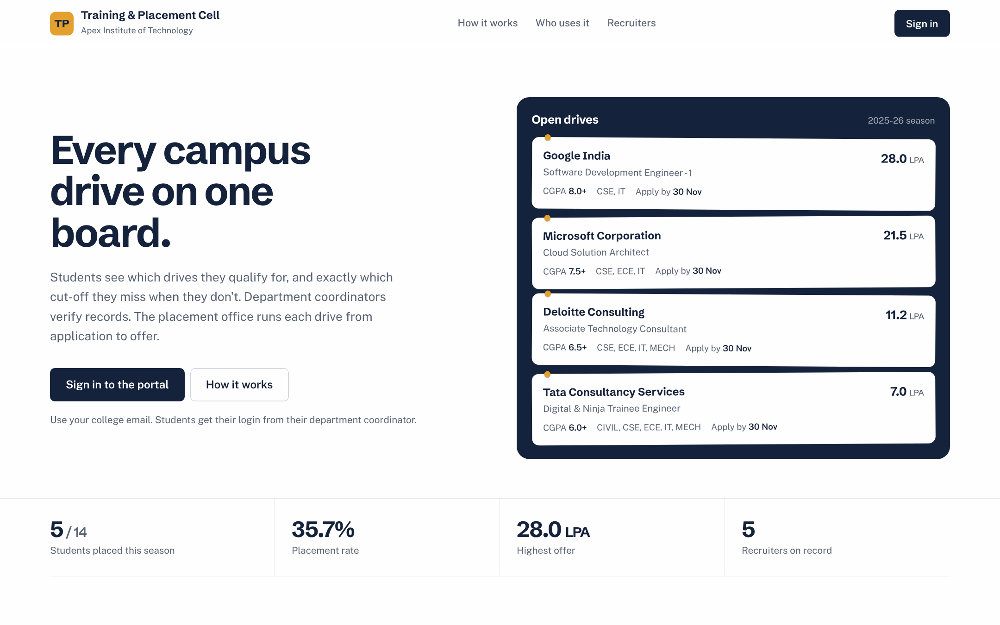
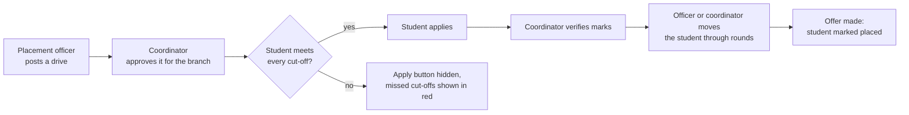
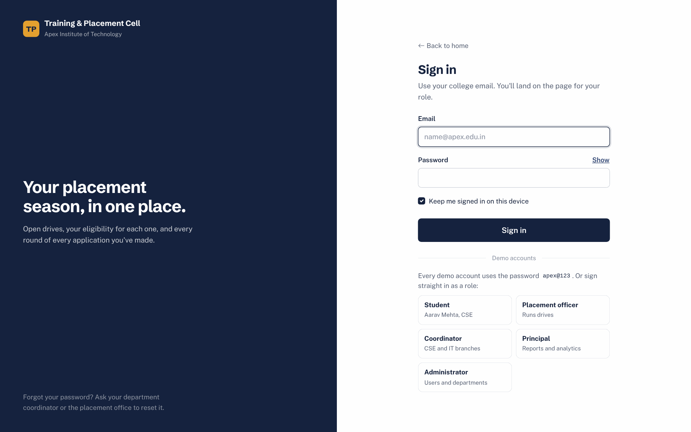
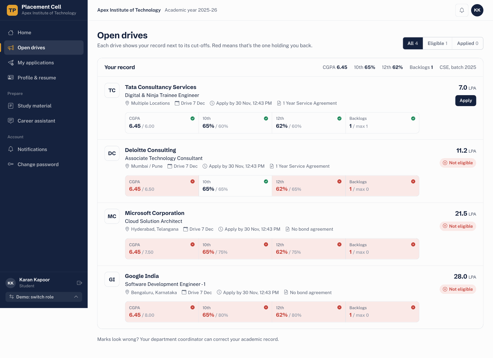
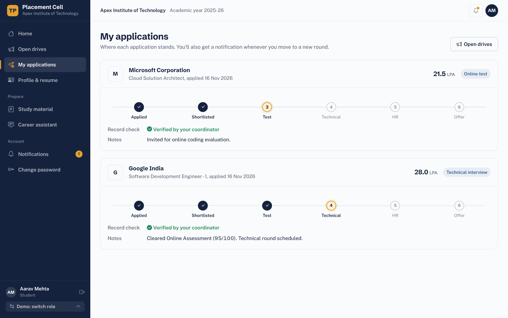
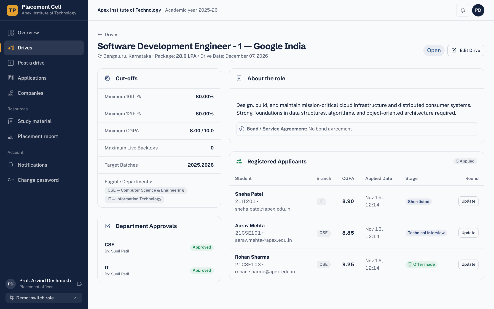
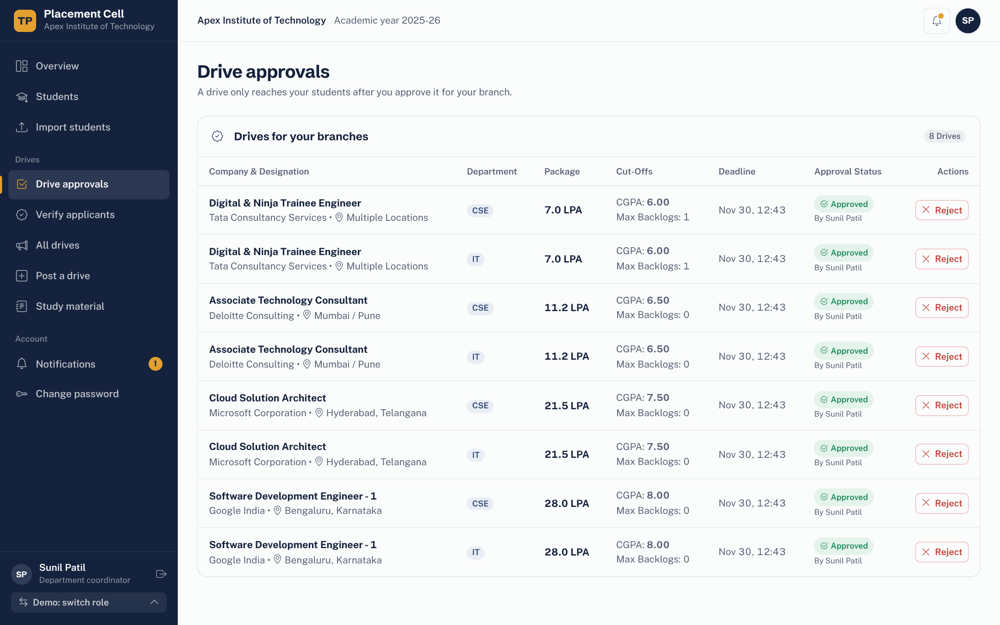
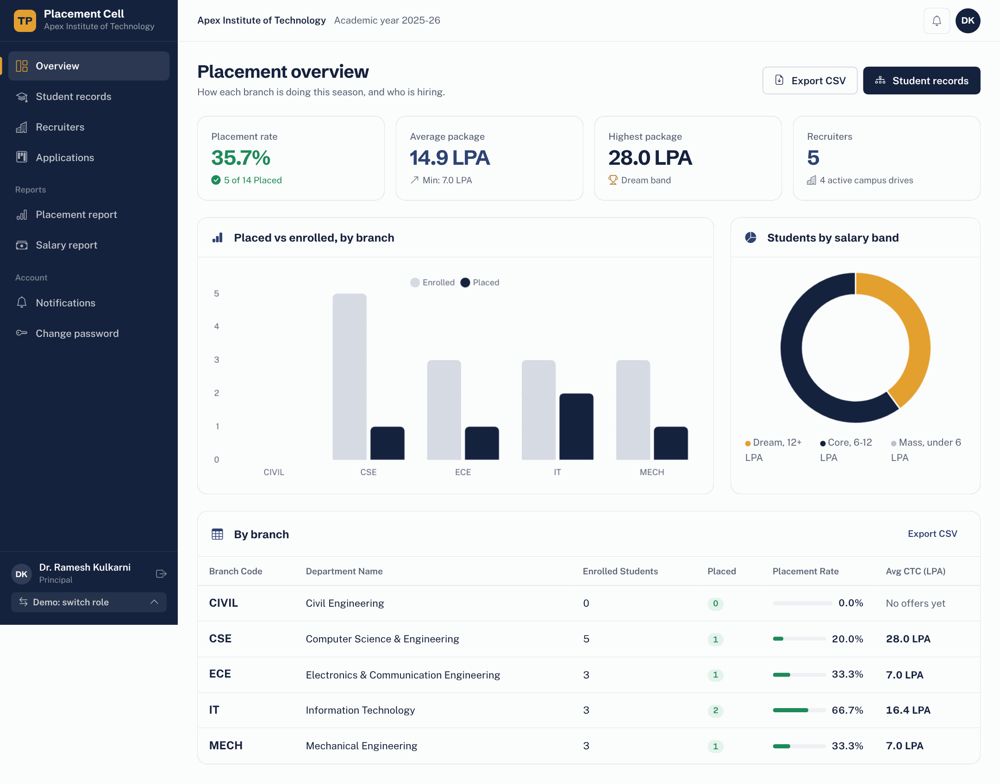
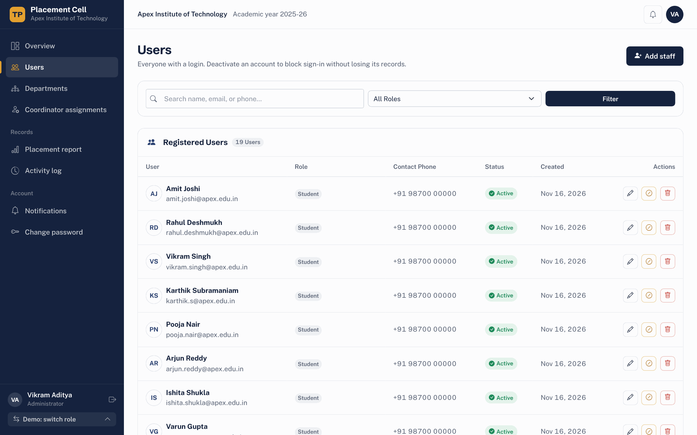
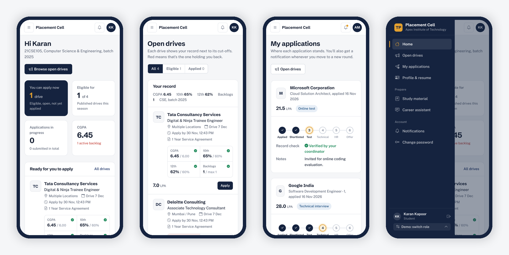

# Training & Placement Cell Portal

A web portal that runs a college's campus placement season: the placement officer posts drives with eligibility cut-offs, department coordinators approve them and verify student marks, students apply to the drives they qualify for, and the principal follows placement numbers branch by branch.



Built with **Django 4.2** and server-rendered templates. No front-end build step. Bootstrap, the icons, Chart.js and the fonts are bundled in `static/vendor/`, so the portal runs without an internet connection.

## Contents

- [What it does](#what-it-does)
- [Screenshots](#screenshots)
- [Run it locally](#run-it-locally)
- [Demo accounts](#demo-accounts)
- [Configuration](#configuration)
- [Tests](#tests)
- [Project structure](#project-structure)
- [Documentation](#documentation)
- [Known limitations](#known-limitations)

## What it does

Five roles sign in at the same page and each lands on their own workspace.

| Role | Main jobs in the portal |
| --- | --- |
| **Student** | See open drives and which cut-offs they meet, apply in one step, track each round, keep a resume and skills on file, use the study library and career assistant |
| **Placement officer** | Post and edit drives, move applicants through rounds to an offer, keep the company directory, publish study material |
| **Department coordinator** | Add or bulk-import students for their branch, approve drives for the branch, verify applicants' marks, update rounds for their own students |
| **Principal** | Placement rate and packages by branch, recruiter summary, filterable student records with CSV export |
| **Administrator** | Staff accounts, departments, which coordinator looks after which branch, activity log |

### How a drive moves



Students are notified when a drive is posted, at every round change, and if their marks are flagged.

### Things worth knowing

- **Eligibility is explained, not just decided.** The check in [`apps/placements/services/eligibility.py`](apps/placements/services/eligibility.py) compares branch, batch, degree, 10th and 12th marks, CGPA and active backlogs, and the student sees each figure next to the cut-off.
- **Coordinators only see their own branches.** Every coordinator query is filtered by the departments assigned to them, and other branches' students return 403.
- **Offers update placement status automatically.** If a student holds two offers, the better package is kept. Revoking one falls back to the other.
- **Resumes are private.** They are served only through a permission-checked view; `/media/resumes/` returns 404.
- **The career assistant works with or without AI.** With a Gemini API key it answers with the student's record and open drives as context. Without one, it gives built-in guidance from the same data.

## Screenshots

| Public: home page | Authentication: sign in |
| --- | --- |
|  |  |
| **Student: home** | **Student: open drives and cut-offs** |
|  |  |
| **Student: tracking applications** | **Student: career assistant** |
|  |  |
| **Placement officer: overview** | **Placement officer: a drive and its applicants** |
|  |  |
| **Department coordinator: drive approvals** | **Department coordinator: student roster** |
|  |  |
| **Principal: placement overview** | **Administrator: user governance** |
|  |  |

On a phone, the sidebar becomes a menu and the cut-off grid reflows:



Every screen, role by role, is in the [user guide](docs/USER_GUIDE.md).

## Run it locally

You need Python 3.10 or newer.

```bash
git clone https://github.com/Ayush7kr/TPMS.git
cd tpms

python -m venv venv
source venv/bin/activate          # Windows: venv\Scripts\activate
pip install -r requirements.txt

python manage.py migrate
python manage.py seed_tpms_data   # demo data
python manage.py runserver
```

Open <http://127.0.0.1:8000> and sign in with any account below.

> **Before a demo, run `python manage.py seed_tpms_data` again.** It resets every drive's deadline to two weeks from today. Without it, drives eventually show as closed.

## Demo accounts

Every demo account uses the password `apex@123`. While `DEMO_MODE` is on, the sign-in page also has one-click buttons for each role.

| Role | Email | Useful for showing |
| --- | --- | --- |
| Student | `aarav.mehta@apex.edu.in` | Eligible for every drive, two applications in progress |
| Student | `karan.kapoor@apex.edu.in` | Misses most cut-offs (CGPA 6.45, one backlog), so the red cut-offs are visible |
| Student | `rohan.sharma@apex.edu.in` | Placed at Google India, 28 LPA |
| Placement officer | `tpo@apex.edu.in` | Drives, applicants, companies |
| Coordinator | `assistant.cse@apex.edu.in` | CSE and IT branches |
| Coordinator | `assistant.ece@apex.edu.in` | ECE only, to show branch isolation |
| Principal | `principal@apex.edu.in` | Reports and CSV export |
| Administrator | `admin@apex.edu.in` | Users, departments, activity log |

## Configuration

Settings are read from environment variables, or from a `.env` file in the project root (copy `.env.example`). All are optional for local use.

| Variable | Default | What it does |
| --- | --- | --- |
| `DJANGO_SECRET_KEY` | a development key | Set a long random value on any real server |
| `DEBUG` | `True` | Set `False` on a real server |
| `ALLOWED_HOSTS` | `127.0.0.1,localhost` | Comma-separated host names the site answers to |
| `DEMO_MODE` | same as `DEBUG` | Shows the one-click role buttons. **Anyone can use them to sign in as admin, so turn this off on a real server.** |
| `GEMINI_API_KEY` | empty | Turns on live AI answers in the career assistant |
| `GEMINI_MODEL` | `gemini-flash-latest` | Gemini model the assistant calls |
| `TPMS_INSTITUTE_NAME` | `Apex Institute of Technology` | Shown across the interface |
| `TPMS_INSTITUTE_SHORT_NAME` | `AIT` | Used in page titles |
| `TPMS_CURRENT_ACADEMIC_YEAR` | `2025-26` | Shown in the top bar and on the landing page |

Deployment notes are in [docs/ARCHITECTURE.md](docs/ARCHITECTURE.md#deploying).

## Tests

```bash
python manage.py test tests apps.career_assistant.tests
```

78 tests, all passing:

| File | Covers | Tests |
| --- | --- | ---: |
| `tests/test_auth.py` | Password hashing, sign-in, deactivated accounts, redirect by role | 6 |
| `tests/test_permissions.py` | Role-restricted pages | 5 |
| `tests/test_department_scoping.py` | Coordinators limited to their branches | 2 |
| `tests/test_eligibility.py` | Cut-off checks | 5 |
| `tests/test_bulk_import.py` | CSV import, duplicates | 2 |
| `tests/test_workflows.py` | Posting, approving, applying, rounds, offers | 7 |
| `tests/test_security_audit.py` | Access to other students' profiles, resumes and rosters; password change | 12 |
| `tests/test_phase3_integration.py` | Withdrawals, offer reversal, deletion rules, drive cancellation | 11 |
| `tests/test_fixes.py` | Regression tests for fixed bugs | 15 |
| `apps/career_assistant/tests.py` | Assistant context, Gemini request, built-in answers | 13 |

## Project structure

```
tpms/
├── apps/
│   ├── accounts/          users, sign-in, admin and principal pages, role decorators
│   ├── departments/       departments, coordinator assignments, coordinator pages
│   ├── students/          student records, bulk import, resume download
│   ├── companies/         company directory
│   ├── placements/        drives, cut-offs, eligibility check
│   ├── applications/      applying, withdrawing, rounds and offers
│   ├── study_materials/   study library
│   ├── notifications/     personal and role-wide notifications
│   ├── analytics/         placement and salary reports
│   ├── career_assistant/  student chat assistant
│   ├── audit/             activity log
│   └── core/              landing page, shared context, error pages, seed command
├── templates/             page templates, one folder per area
├── static/                style.css (design system), app.js, bundled vendor files
├── tests/
├── docs/                  architecture, database, permissions, user guide, requirements
└── manage.py
```

## Documentation

| Document | Read it for |
| --- | --- |
| [User guide](docs/USER_GUIDE.md) | Every screen, role by role, with screenshots |
| [Architecture](docs/ARCHITECTURE.md) | How the code is organised, key flows, deploying |
| [Database](docs/DATABASE.md) | Tables, fields and relationships |
| [Roles and permissions](docs/PERMISSIONS.md) | Who can open what, and how it's enforced |
| [Requirements](docs/REQUIREMENTS.md) | Each requirement from the [project brief](docs/project-brief.pdf) and where it's met |
| [Changelog](CHANGELOG.md) | What changed in each version |

## Known limitations

- Accounts are created by the admin or a coordinator; there is no self-registration or email verification.
- Marks support 10th, 12th and a 10-point CGPA. There is no post-graduation field.
- The analytics pages show the whole institution to coordinators too, not just their branches.
- The dashboards count all students, not only the current academic year.
- Uses SQLite, which suits a demo or a single college office. A busy multi-user deployment should move to PostgreSQL.
