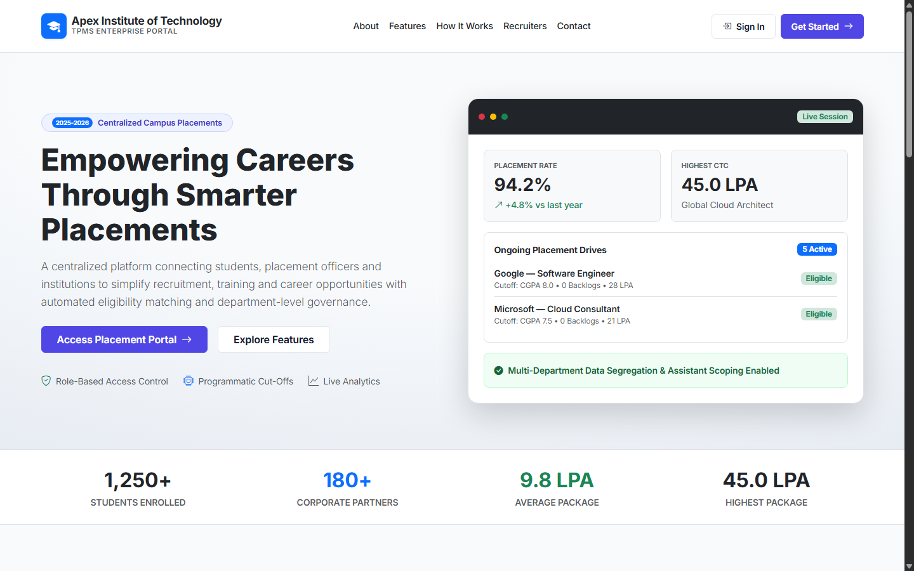
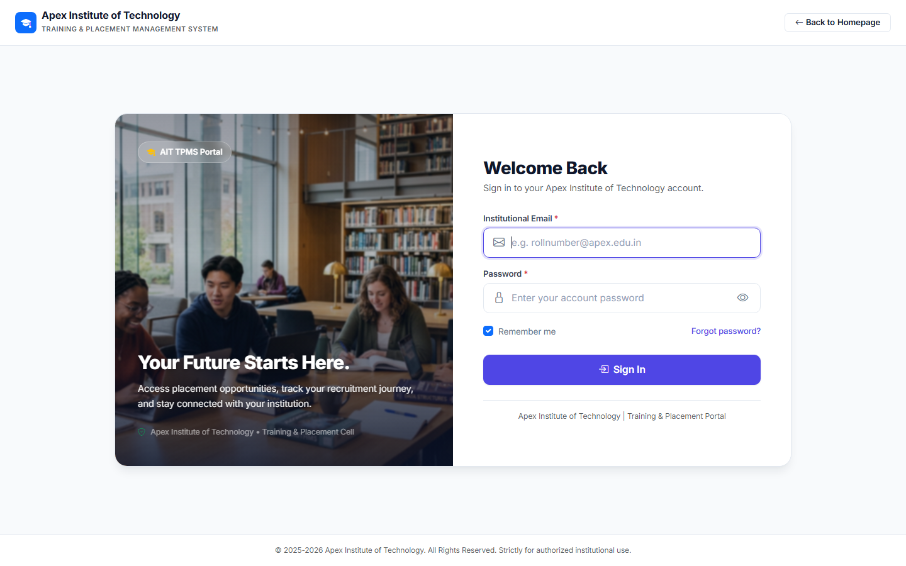
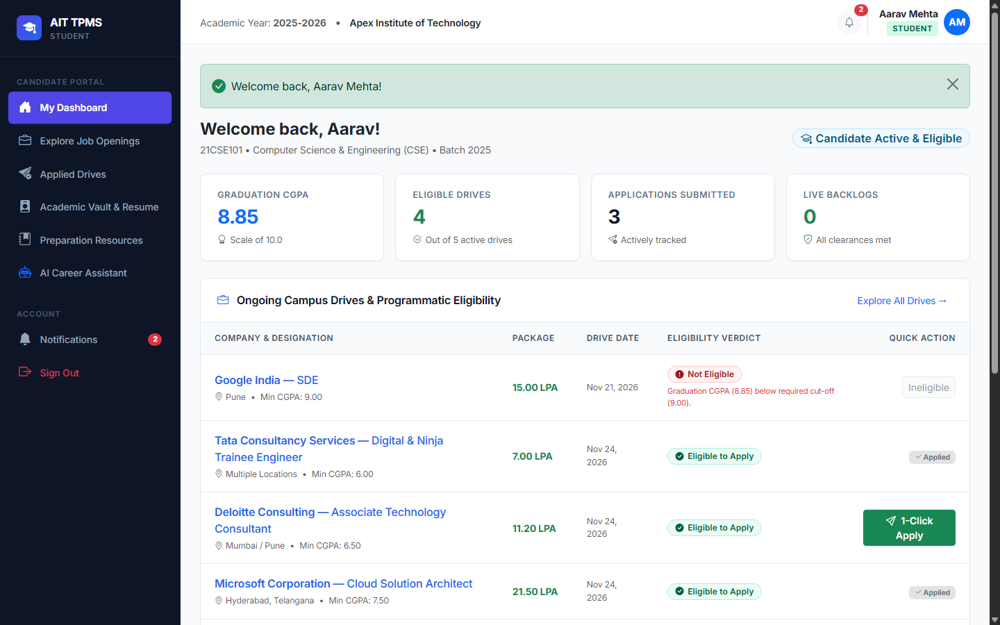
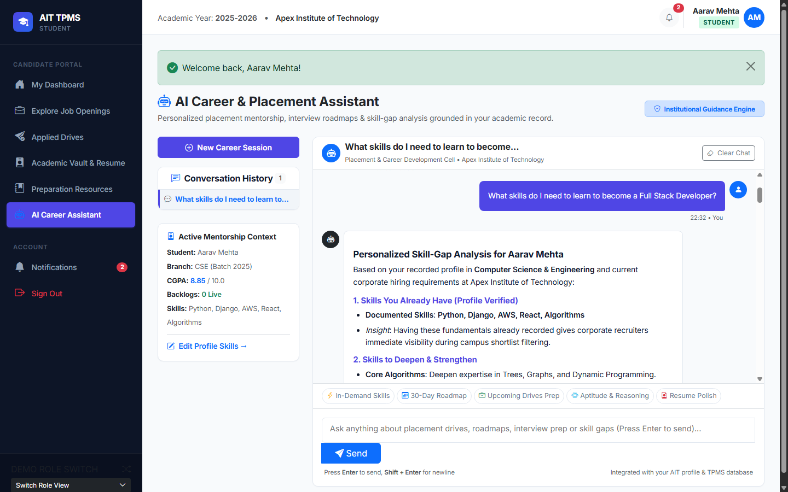
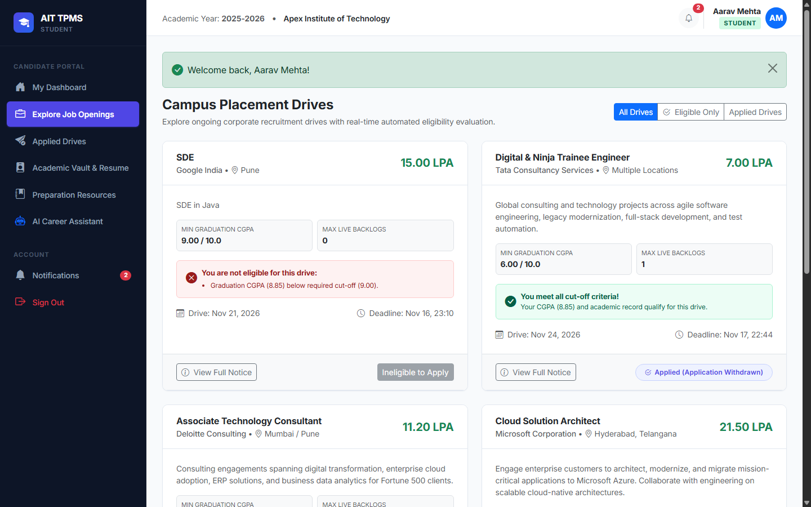
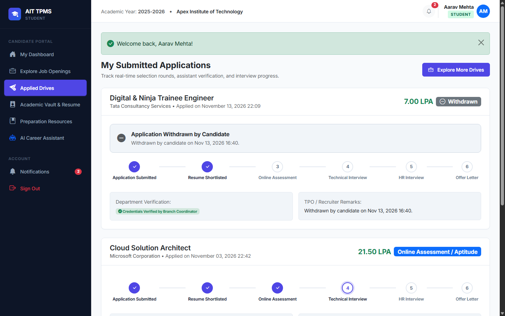
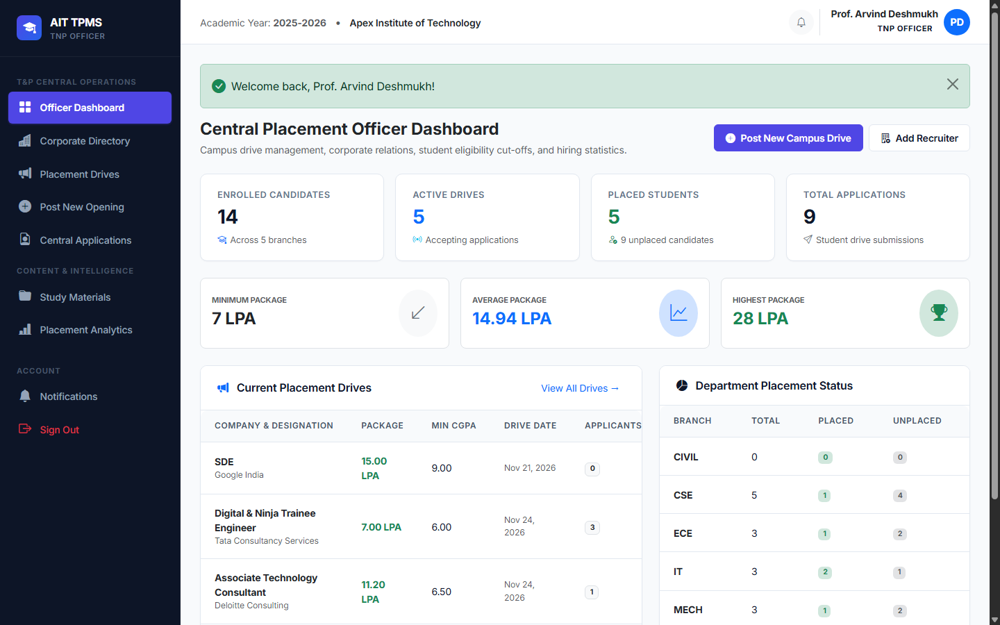
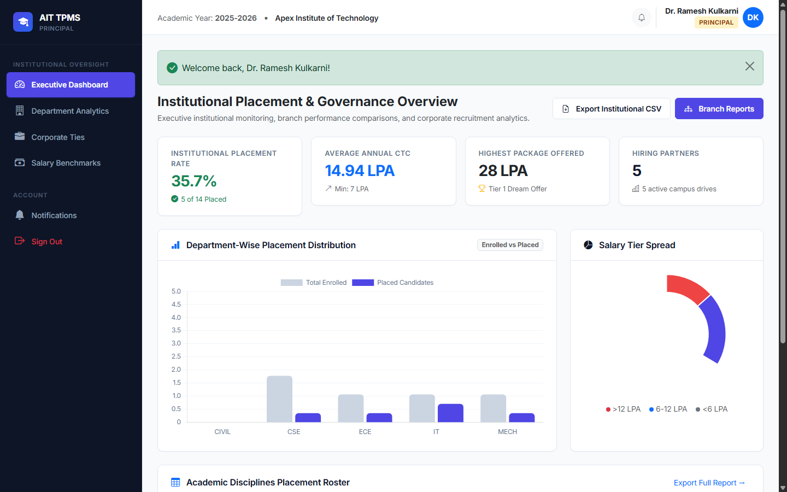
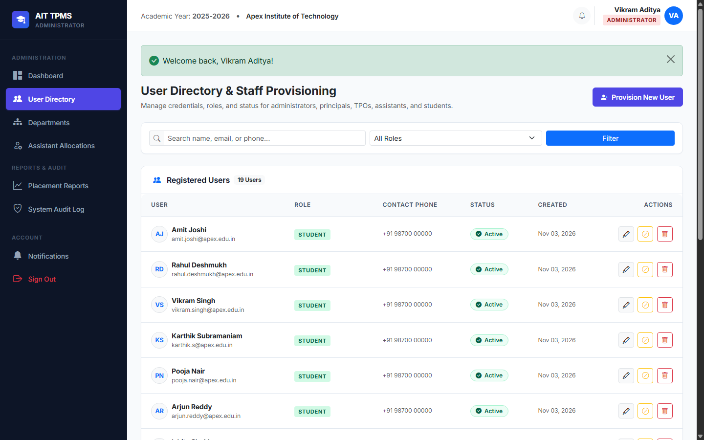
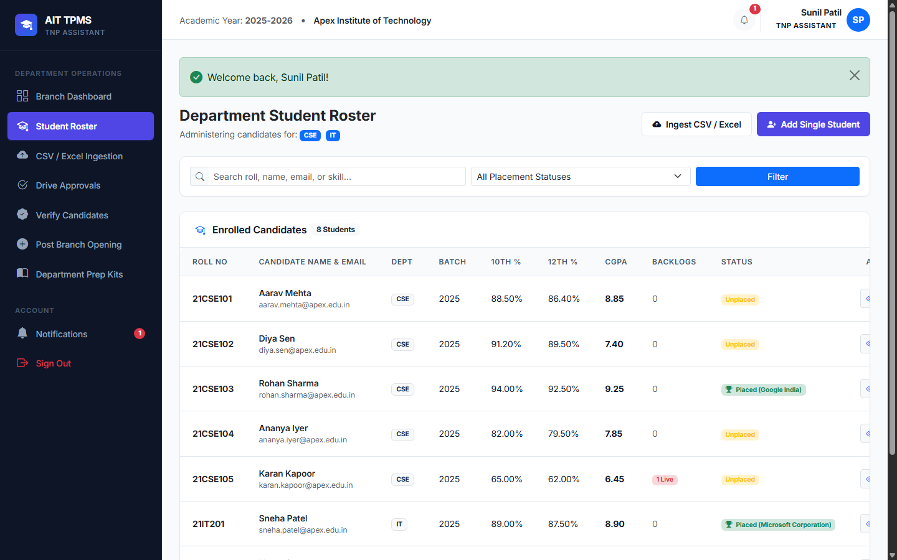

# Training and Placement Management System (TPMS)
### Apex Institute of Technology — Enterprise Campus Recruitment Platform

An enterprise-grade, full-stack web application engineered to digitize, unify, and govern the end-to-end recruitment, eligibility matching, and placement workflows for higher education institutions.

Built in strict compliance with the **Institutional TPMS Requirements Specification** and high-fidelity enterprise UI design principles.

---

## 1. Technology Stack & Architectural Constraints

- **Backend Framework**: Python 3.12 / Django 4.2+ (LTS)
- **Database**: SQLite Relational Engine (`db.sqlite3` with transactional atomicity)
- **Frontend Presentation**: Custom HTML5, CSS3, Bootstrap 5.3, Vanilla JavaScript (ES6+)
- **Design System**: Linear / Stripe Enterprise Aesthetic (`static/css/style.css`, Inter typography, subtle shadows, flush data tables, and status pills)
- **Data Visualization**: Chart.js 4.4+ (dynamic canvas visualizations for placement percentages & salary tier distributions)
- **File Parsing & Ingestion**: `openpyxl` (Excel .xlsx), native `csv` (CSV ingestion)
- **Strict Development Rules Complied With**:
  - **Zero Default Django Admin**: `django.contrib.admin` disabled and unexposed.
  - **Zero Django Forms / ModelForms**: 100% custom HTML forms with manual server-side validation and contextual field error reporting.
  - **Zero Client-Side Framework Overhead**: No React/Angular/Vue; ultra-fast server-rendered Django templates.
  - **Cryptographic Security**: Passwords hashed using PBKDF2 with SHA-256 (no plain text).
  - **Multi-Tenant Department Isolation**: TnP Assistant actions are strictly bounded to assigned academic branches.

---

## 2. Five Institutional User Roles & Pre-Seeded Credentials

All demonstration accounts are pre-seeded in the database with the default password: **`apex@123`**

| Role | Email Address | Access Level & Core Mandate |
| :--- | :--- | :--- |
| **Administrator** | `admin@apex.edu.in` | Department master data, user provisioning, assistant allocation, and system audit log. |
| **Principal** | `principal@apex.edu.in` | Executive institutional oversight, branch comparisons, salary benchmarks, and CSV export. |
| **TnP Officer** | `tpo@apex.edu.in` | Corporate partner directory, drive creation with cut-offs, central applicant tracker, and prep kits. |
| **TnP Assistant** | `assistant.cse@apex.edu.in` | Department coordinator (CSE & IT): student CSV/Excel ingestion, drive approvals, marks verification. |
| **TnP Assistant** | `assistant.ece@apex.edu.in` | Department coordinator (ECE): branch student roster and local drive review. |
| **Student (Eligible)** | `aarav.mehta@apex.edu.in` | B.Tech CSE, CGPA 8.85, 0 backlogs — qualifies for top drives (Google, Microsoft), 1-click apply. |
| **Student (Placed)** | `rohan.sharma@apex.edu.in` | B.Tech CSE, CGPA 9.25, Placed at Google India (28.00 LPA). |
| **Student (Cut-off Test)** | `karan.kapoor@apex.edu.in` | B.Tech CSE, CGPA 6.45, 1 live backlog — demonstrates live cut-off ineligibility rejection. |

*Tip: A dedicated **1-Click Demo Role Switcher** is present on both the custom login page and the sidebar footer for frictionless evaluation during project mentor demonstrations.*

---

## 3. Platform Screenshots & Visual Interface

Live, authentic interface captures from the running application:

### 3.1 Public Recruitment Portal & Institutional Overview
The public landing page highlights institutional accreditation, verified placement percentages, real-time metrics, and corporate partner showcases.


### 3.2 Role-Based Authentication & 1-Click Demo Persona Switcher
Clean, high-contrast login portal featuring role-selection tabs and an instant 1-click demonstration switcher for all 5 user roles.


### 3.3 Student Portal — Interactive Drives & Academic Status
Candidate dashboard displaying academic standing (B.Tech CSE, CGPA 8.85), active recruitment drives with clean clickable links, and live programmatic eligibility verdicts.


### 3.4 AI Career & Placement Assistant Guidance Interface
Personalized placement mentorship interface with rich Markdown guidance, skill gap analysis, starter prompt chips, and customized study roadmaps.


### 3.5 Explore Campus Drives & Cut-Off Eligibility Engine
Corporate drive catalog detailing salary CTC packages, drive dates, cut-off criteria, and instant 1-click application actions.


### 3.6 Applied Drives Tracker & Selection Pipeline Stepper
Visual recruitment progression stepper (`Applied` → `Shortlisted` → `Technical Round` → `HR Round` → `Offered`) with status badges and withdrawal capability.


### 3.7 TPO Central Placement Operations Dashboard
Training & Placement Officer command center for monitoring institutional drives, student applications, company directories, and package statistics.


### 3.8 Principal Institutional Executive Analytics
High-level executive oversight displaying branch-wise placement comparisons, tier distribution, and one-click placement CSV exports.


### 3.9 Administrator User Provisioning & Staff Governance Panel
System governance dashboard managing accounts across Principal, TPO, and Department Assistants with status toggling and department allocations.


### 3.10 Department Placement Assistant Scoped Student Roster
Department-isolated student management portal displaying verified CSE candidate metrics, academic performance, and resume access.


---

## 4. Quick Start & Execution Commands

### 4.1 Start Local Development Server
```bash
python manage.py runserver
```
Visit **`http://127.0.0.1:8000/`** to access the public portal and click **Sign In** or **Get Started**.

### 4.2 Run the Automated Test Suite
```bash
python manage.py test tests apps.career_assistant.tests
```
*Executes all 63 unit and integration tests (Auth, RBAC, Cut-off Eligibility Engine, Multi-Tenant Scoping, Bulk Ingestion, AI Career Assistant, and Interactive Dashboard) with 100% pass rate.*

### 4.3 Configure AI Career Assistant (Optional)
The AI Assistant includes a built-in institutional rule-based guidance engine that works out of the box with zero external dependencies. To enable live LLM synthesis via Google Gemini API:
1. Copy `.env.example` to `.env`.
2. Add your Gemini API key:
   ```bash
   GEMINI_API_KEY=your_gemini_api_key_here
   ```

### 4.4 Re-Seed the Demonstration Database
```bash
python manage.py seed_tpms_data
```
*Populates 5 departments, 5 staff accounts, 5 corporate partners, 14 student academic profiles, active campus drives, and selection stages.*

---

## 5. Modular Codebase Architecture

```
f:\tpms\
│
├── manage.py                     # Django runtime CLI
├── requirements_extracted.txt    # Extracted text from approved specification
├── The Training and Placement Management System.pdf
├── db.sqlite3                    # Relational database
├── .env.example                  # Environment configuration template (Gemini API key)
│
├── tpms_project/                 # Core configuration
│   ├── settings.py               # Custom User model, modular apps, static/media
│   └── urls.py                   # Master URL routing
│
├── docs/                         # Engineering specifications
│   ├── screenshots/              # Visual architecture & interface captures
│   ├── PROJECT_OVERVIEW.md       # Purpose, scope, and non-functional requirements
│   ├── REQUIREMENTS_BREAKDOWN.md # Granular module and field-level breakdown
│   ├── SYSTEM_ARCHITECTURE.md    # Modular monolith design, layers, security
│   ├── DATABASE_DESIGN.md        # Relational schema & Mermaid ER diagram
│   ├── ROLE_PERMISSION_MATRIX.md # Exhaustive RBAC authorization rules
│   ├── IMPLEMENTATION_ROADMAP.md # Phase-by-phase execution milestones
│   ├── PROGRESS_REPORT.md        # Milestone tracking & 100% verification
│   └── UI_UX_REFINEMENT_REPORT.md# Interface standards & light theme specification
│
├── apps/                         # Modular Django applications
│   ├── accounts/                 # Custom User model, email login, auth views, RBAC decorators
│   ├── core/                     # Public landing page, global context, error handlers, seeder
│   ├── departments/              # Department catalog & Assistant scoping
│   ├── students/                 # Student profile vault, CSV/Excel bulk ingestion engine
│   ├── companies/                # Corporate employer directory & recruiter POCs
│   ├── placements/               # Placement drives, cut-off parameters, department approvals
│   ├── applications/             # 1-Click apply, verification, multi-round stage progression
│   ├── study_materials/          # Preparation resource library (PDFs, videos, links)
│   ├── notifications/            # In-app alerts and role broadcasts
│   ├── analytics/                # Aggregations, salary stats, and Chart.js payloads
│   ├── audit/                    # Immutable system activity trail
│   └── career_assistant/         # AI Career Assistant (models, prompt builder, context builder, Gemini & local fallback)
│
├── static/                       # Static UI assets
│   ├── css/style.css             # Linear/Stripe design system, enterprise light theme palette, timeline/stepper
│   └── js/app.js                 # Toast auto-dismiss, live search, drag-and-drop, Chart.js defaults
│
├── templates/                    # Custom HTML templates (No Django Forms)
│   ├── base/                     # base.html, dashboard_base.html, notifications.html
│   ├── public/                   # landing.html, login.html, error.html
│   ├── admin_panel/              # User provisioning, department governance, assignments, audit
│   ├── principal_panel/          # Executive oversight, Chart.js visuals, CSV export
│   ├── tpo_panel/                # Central drives, package benchmarks, post opening
│   ├── assistant_panel/          # Scoped student roster, drive approvals, applicant verification
│   ├── student_panel/            # Candidate vault, live eligibility matcher, 1-click apply, AI assistant
│   ├── companies/                # Corporate directory, company form
│   ├── placements/               # Drives list, drive detail, post job form
│   ├── applications/             # Central tracker, stage progression
│   ├── students/                 # Bulk CSV/Excel ingestion, candidate detail
│   └── study_materials/          # Resource library, asset upload form
│
└── tests/                        # Automated unit test suite
    ├── test_auth.py              # Password hashing & email authentication
    ├── test_permissions.py       # Role-based access control enforcement
    ├── test_eligibility.py       # Deterministic cut-off criteria engine
    ├── test_department_scoping.py# Multi-tenant assistant branch scoping
    ├── test_bulk_import.py       # CSV bulk ingestion & duplicate handling
    ├── test_security_audit.py    # Privacy & role authorization audit
    ├── test_workflows.py         # Multi-step integration workflows
    └── test_phase3_integration.py# Application withdrawal, session eviction & cascaded deletion
```
