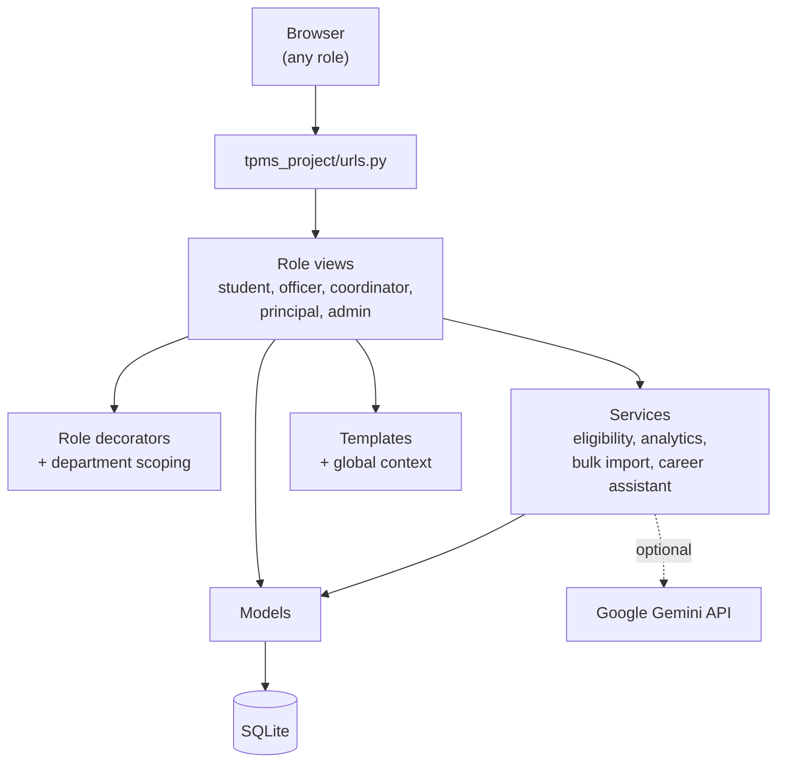
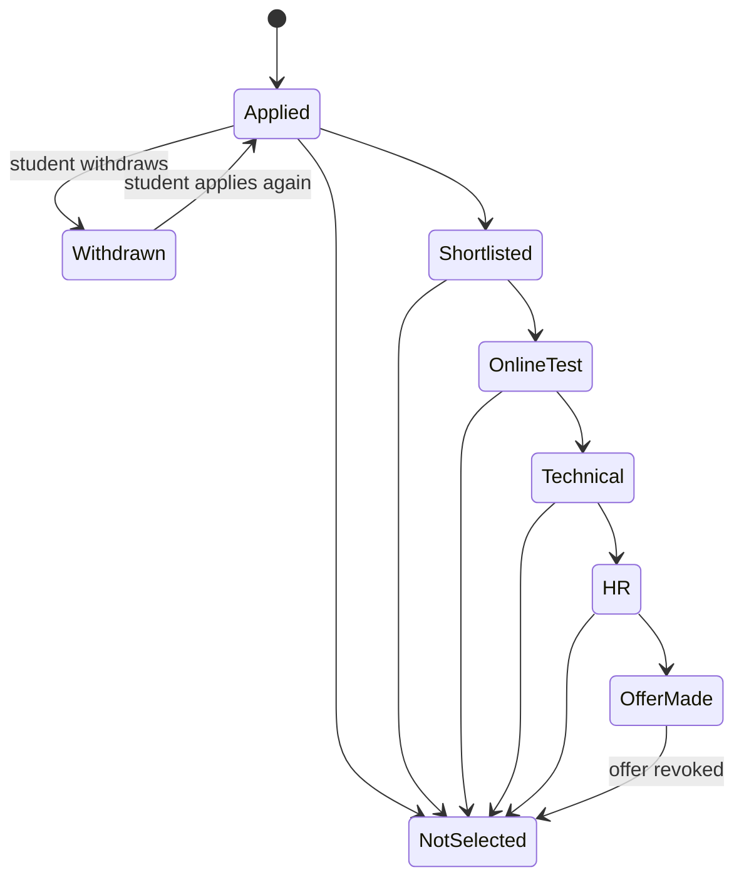

# Architecture

How the portal is put together, how its main flows work, and how to deploy it.

- [Stack](#stack)
- [How the pieces fit](#how-the-pieces-fit)
- [Django apps](#django-apps)
- [Access control](#access-control)
- [Key flows](#key-flows)
- [Front end](#front-end)
- [Deploying](#deploying)

## Stack

| Layer | Choice | Notes |
| --- | --- | --- |
| Language | Python 3.10+ | |
| Framework | Django 4.2 (LTS) | Server-rendered templates, no REST layer |
| Database | SQLite | Single file, `db.sqlite3` |
| UI | Bootstrap 5.3, Bootstrap Icons, custom design system in `static/css/style.css` | All bundled in `static/vendor/` |
| Charts | Chart.js 4 | Bundled |
| Chat rendering | marked + DOMPurify | Bundled; assistant replies are Markdown, sanitised before display |
| Spreadsheets | openpyxl | Reads `.xlsx` imports |
| AI (optional) | Google Gemini REST API via `requests` | Only used when `GEMINI_API_KEY` is set |
| Config | python-dotenv | Reads `.env` if present |

Django's built-in admin site (`django.contrib.admin`) is not installed. All administration happens through the portal's own administrator pages.

## How the pieces fit

Each request goes through a role check, then a view that reads models directly or calls a service, then a template. Business rules that more than one page needs live in services, so the eligibility check is the same on the student's drive list, the drive page and the apply action.

## Django apps

Every app lives under `apps/`.

| App | Responsible for | Key files |
| --- | --- | --- |
| `accounts` | Custom `User` (email login, role), sign-in and redirects, notifications page, password change, administrator and principal pages | `models.py`, `decorators.py`, `views.py`, `admin_views.py`, `principal_views.py` |
| `core` | Public landing page, global template context, error pages, demo data | `views.py`, `context_processors.py`, `management/commands/seed_tpms_data.py` |
| `departments` | Branches, coordinator-to-branch assignments, coordinator pages | `models.py`, `assistant_views.py` |
| `students` | Student academic records, CSV/Excel import, private resume download, student pages | `models.py`, `services/bulk_import.py`, `student_views.py`, `views.py` |
| `companies` | Recruiter directory | `models.py`, `views.py` |
| `placements` | Drives, cut-offs, per-branch approvals, the eligibility check, placement officer pages | `models.py`, `services/eligibility.py`, `views.py`, `tpo_views.py` |
| `applications` | Applying, withdrawing, rounds, offers and placement status | `models.py`, `views.py` |
| `study_materials` | Study library (files, videos, links), optionally per branch or per drive | `models.py`, `views.py` |
| `notifications` | Personal and role-wide notifications with per-user read state | `models.py` |
| `analytics` | Placement and salary figures, chart data | `services/analytics_service.py`, `views.py` |
| `career_assistant` | Student chat: conversations, context building, Gemini call, built-in fallback | `services/context_builder.py`, `services/prompt_builder.py`, `services/ai_service.py` |
| `audit` | Activity log entries | `models.py` |

The database tables are described in [DATABASE.md](DATABASE.md).

## Access control

**Sign-in.** Users sign in with email and password (`accounts.User` uses email as the username; passwords are hashed with Django's PBKDF2 default). After sign-in, `User.get_dashboard_url()` sends each role to its own home page. Deactivated accounts can't sign in, and an active session is ended if the account is deactivated.

**Role checks.** Views are wrapped in decorators from `apps/accounts/decorators.py`:

| Decorator | Allows |
| --- | --- |
| `login_required_custom` | Any signed-in user |
| `role_required([...])` | The listed roles. Superusers pass every check; the seeded administrator is a superuser. |
| `admin_required`, `principal_required`, `tpo_required`, `assistant_required` | Shortcuts for the matching roles (principal pages also allow the admin; coordinator pages also allow the admin) |
| `student_required` | Students only, and shows an explanation page instead of crashing if the student has no academic record yet |

**Department scoping.** Coordinators are further limited to the branches assigned to them. `get_assistant_departments(user)` in `apps/departments/assistant_views.py` returns those branches, and every coordinator query filters by it: rosters, approvals, verification lists, drive applicant lists, student profiles, resumes and round updates. A request for another branch's record returns 403.

**Files.** Resumes are never served from `/media/`. The `students:download_resume` view checks that the requester is the student, a coordinator for that branch, or central staff, then streams the file.

**Forms.** Every state-changing action is a POST with Django's CSRF protection, including deactivating users and the demo role switcher.

The full who-can-open-what table is in [PERMISSIONS.md](PERMISSIONS.md).

## Key flows

### Posting and approving a drive

1. The placement officer (or a coordinator) posts a drive with its cut-offs and eligible branches. The form checks that the deadline is in the future, the drive date isn't before the deadline, and every cut-off is in range.
2. One `DepartmentJobApproval` row is created per eligible branch, starting as pending. All students receive a role-wide notification.
3. Each branch's coordinator approves or rejects the drive for their branch. Students of a branch can apply only after its approval.

### The eligibility check

`EligibilityEngine.evaluate(student, drive)` in `apps/placements/services/eligibility.py` runs these checks and collects every failure, so the student sees all reasons at once:

1. The student's branch is one of the drive's branches.
2. The coordinator has approved the drive for that branch.
3. The student's batch is in the drive's batches.
4. The student's degree is in the drive's degrees.
5. 10th percentage meets the minimum.
6. 12th percentage meets the minimum.
7. CGPA meets the minimum.
8. Active backlogs don't exceed the maximum.

It returns whether the student is eligible, the reasons if not, the per-figure comparison used for the red/green grid, whether the deadline has passed, and any existing application. A student **can apply** only if they're eligible, the deadline hasn't passed, the drive is published, and they have no active application (a withdrawn one doesn't count).

### Application rounds

Rounds are set by the placement officer, or by a coordinator for their own branch. The update form allows moving to any round, so a drive without, say, an online test can skip it. Withdrawn applications and applications to cancelled drives can't be moved. Students can withdraw only while the application is at **Applied**.

**Offers and placement status.** Setting **Offer made** marks the student placed, with that company and package, unless they already hold a better-paid offer. Moving an offered application to any other round falls back to the student's best remaining offer, or marks them unplaced if there is none. The student is notified at every change.

### Notifications

A notification is either personal (`recipient` set) or role-wide (`recipient` empty, `target_role` set, for example every student when a drive is posted). Personal notifications use `is_read`; role-wide ones record who has read them in `read_by`, so one student marking a drive announcement as read doesn't mark it for everyone. The unread count in the top bar comes from `unread_notifications_for(user)` in `apps/core/context_processors.py`.

### Bulk student import

`BulkImportService.parse_file()` in `apps/students/services/bulk_import.py` reads a CSV or `.xlsx` file for one branch. For each row it skips duplicates (email, roll number or PRN already on file), rejects rows with missing fields or out-of-range marks and reports them by row number, and creates a user plus student record for every valid row, with the default password `apex@123`. Valid rows are imported even when other rows fail.

### Career assistant

1. `ContextBuilder` collects the student's record, skills, applications, the drives they're eligible for and relevant study material.
2. `PromptBuilder` turns that into a system prompt.
3. With `GEMINI_API_KEY` set, `CareerAssistantService` sends the system prompt and the last 12 messages of the conversation to the Gemini `generateContent` endpoint for the model in `GEMINI_MODEL`.
4. Without a key, or if the call fails, it answers from built-in guidance generated from the same context, and says so at the end of the reply.

Conversations and messages are stored in `career_assistant_conversation` and `career_assistant_chatmessage`, so students can return to past chats.

### Activity log

Important actions write an `AuditLog` row: sign-ins, password changes, creating, editing, deactivating or deleting users, department changes, coordinator assignments, student creation and imports, company creation, drive posts and edits, branch approvals, applications, withdrawals, round changes and study material uploads. The administrator reads it under **Activity log**.

## Front end

- **Templates** are in `templates/`, one folder per area. Every signed-in page extends `templates/base/dashboard_base.html` (sidebar, top bar, messages); public pages extend `templates/base/base.html`.
- **Design system**: `static/css/style.css` defines the palette (ink navy `#15233F`, marigold `#E3A02F` as the single accent, green `#1E8A5A` and red `#C23B32` only for eligible/ineligible and status), the type (Schibsted Grotesk for headings, Public Sans for text), and the shared components: cards, tables, badges, forms, the cut-off grid and the round stepper. It also re-maps Bootstrap's variables, so stock Bootstrap classes follow the same palette.
- **JavaScript**: `static/js/app.js` handles the mobile menu, auto-dismissing success messages, confirmation prompts on destructive actions, drag-and-drop file inputs, and Chart.js defaults. There is no build step.

## Deploying

The project runs as-is for a demo or a local office machine. For a server that other people reach over the network:

1. **Settings**: set `DEBUG=False`, `DEMO_MODE=False`, a long random `DJANGO_SECRET_KEY`, and `ALLOWED_HOSTS` to your domain. With `DEBUG=False`, session and CSRF cookies are marked secure, so serve the site over HTTPS (or set `SECURE_COOKIES=False` for a plain-HTTP intranet).
2. **Static files**: run `python manage.py collectstatic` and serve `staticfiles/` from the web server.
3. **Media files**: Django doesn't serve uploads when `DEBUG=False`. Serve `media/` from the web server **except `media/resumes/` and `media/avatars/`**, which must stay private; resumes are already streamed through the permission-checked download view.
4. **App server**: run Django under a WSGI server such as Gunicorn (`gunicorn tpms_project.wsgi`) behind Nginx or similar.
5. **Database**: SQLite is fine for light use. For many concurrent users, change `DATABASES` in `tpms_project/settings.py` to PostgreSQL and run `python manage.py migrate`.
6. **First accounts**: don't run `seed_tpms_data` on a real deployment, because it creates demo accounts with a shared password. Create the first administrator with `python manage.py createsuperuser` and set its role to `ADMIN`.
