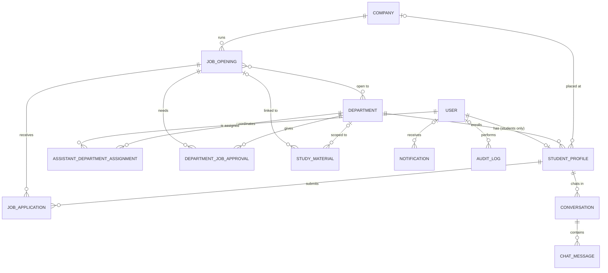

# Database

The portal uses SQLite through Django's ORM. There are 13 main tables, 4 join tables for the many-to-many fields, and Django's own tables for sessions, migrations and content types. Migrations are in each app's `migrations/` folder.

## Relationships

## Tables

Every table has an auto-increment `id` primary key, not repeated below. "FK" is a foreign key; "null" means the field is optional.

### `accounts_user`

Everyone who can sign in. Email is the login.

| Field | Type | Notes |
| --- | --- | --- |
| `email` | varchar | Unique; used to sign in |
| `password` | varchar | PBKDF2 hash |
| `first_name`, `last_name` | varchar | |
| `role` | varchar | `ADMIN`, `PRINCIPAL`, `TNP_OFFICER` (placement officer), `TNP_ASSISTANT` (department coordinator), `STUDENT` |
| `phone` | varchar | null |
| `avatar` | file | null |
| `is_active` | boolean | Deactivated users can't sign in |
| `is_staff`, `is_superuser` | boolean | The seeded administrator is a superuser |
| `last_login`, `date_joined` | datetime | |

### `departments_department`

Academic branches.

| Field | Type | Notes |
| --- | --- | --- |
| `code` | varchar | Unique, for example `CSE` |
| `name` | varchar | Unique |
| `description` | text | null |
| `is_active` | boolean | |
| `created_at`, `updated_at` | datetime | |

### `departments_assistantdepartmentassignment`

Which coordinator looks after which branch. A coordinator can have several branches.

| Field | Type | Notes |
| --- | --- | --- |
| `assistant` | FK → user | |
| `department` | FK → department | |
| `assigned_by` | FK → user | null |
| `assigned_at` | datetime | |

Unique together: (`assistant`, `department`).

### `students_studentprofile`

A student's academic record, one per student user.

| Field | Type | Notes |
| --- | --- | --- |
| `user` | one-to-one → user | |
| `department` | FK → department | |
| `roll_number` | varchar | Unique |
| `prn_number` | varchar | Unique |
| `gender` | varchar | `MALE`, `FEMALE`, `OTHER` |
| `date_of_birth` | date | null |
| `batch_year` | integer | Passing year |
| `degree` | varchar | For example `B.Tech` |
| `tenth_percentage` | decimal(5,2) | 0 to 100 |
| `twelfth_percentage` | decimal(5,2) | 0 to 100 |
| `graduation_cgpa` | decimal(4,2) | 0 to 10 |
| `active_backlogs` | integer | |
| `history_of_backlogs` | integer | |
| `resume` | file | null; private, served only through the download view |
| `skills` | text | Comma-separated |
| `linkedin_url`, `github_url` | URL | null |
| `placement_status` | varchar | `UNPLACED`, `PLACED`, `OPTED_OUT` |
| `placed_company` | FK → company | null; set automatically by offers |
| `salary_package` | decimal(6,2) | null; LPA, set automatically by offers |
| `created_at`, `updated_at` | datetime | |

### `companies_company`

Recruiters.

| Field | Type | Notes |
| --- | --- | --- |
| `name` | varchar | Unique |
| `website` | URL | null |
| `industry_sector` | varchar | |
| `tier` | varchar | Salary band: `TIER_1_DREAM` (12+ LPA), `TIER_2_CORE` (6 to 12), `TIER_3_MASS` (under 6) |
| `contact_person`, `contact_email` | varchar | Recruiter contact |
| `contact_phone`, `address` | varchar, text | null |
| `logo` | file | null |
| `is_active` | boolean | |
| `created_at`, `updated_at` | datetime | |

### `placements_jobopening`

A campus drive.

| Field | Type | Notes |
| --- | --- | --- |
| `company` | FK → company | |
| `title` | varchar | Role |
| `role_description` | text | |
| `job_location` | varchar | |
| `package_ctc` | decimal(6,2) | LPA |
| `bond_details` | varchar | null |
| `min_tenth_percentage`, `min_twelfth_percentage` | decimal(5,2) | 0 means no cut-off |
| `min_graduation_cgpa` | decimal(4,2) | 0 means no cut-off |
| `max_active_backlogs` | integer | |
| `allowed_departments` | many-to-many → department | Branches the drive is open to |
| `allowed_batches` | varchar | Comma-separated years |
| `allowed_degrees` | varchar | Comma-separated |
| `application_deadline` | datetime | Timezone-aware |
| `drive_date` | date | Not before the deadline |
| `status` | varchar | `DRAFT`, `PUBLISHED` (open), `IN_PROGRESS`, `COMPLETED`, `CANCELLED` |
| `created_by` | FK → user | null |
| `created_at`, `updated_at` | datetime | |

### `placements_departmentjobapproval`

One row per drive per eligible branch. Students of a branch can apply only once their row is approved.

| Field | Type | Notes |
| --- | --- | --- |
| `job_opening` | FK → drive | |
| `department` | FK → department | |
| `status` | varchar | `PENDING`, `APPROVED`, `REJECTED` |
| `reviewed_by` | FK → user | null |
| `reviewed_at` | datetime | null |
| `comments` | text | null |

Unique together: (`job_opening`, `department`).

### `applications_jobapplication`

A student's application to a drive.

| Field | Type | Notes |
| --- | --- | --- |
| `job_opening` | FK → drive | |
| `student` | FK → student profile | |
| `stage` | varchar | `APPLIED`, `SHORTLISTED`, `ASSESSMENT` (online test), `TECHNICAL_ROUND`, `HR_ROUND`, `OFFERED`, `REJECTED`, `WITHDRAWN` |
| `stage_updated_at` | datetime | |
| `verification_status` | varchar | `PENDING`, `VERIFIED`, `FLAGGED` (marks mismatch) |
| `verified_by` | FK → user | null |
| `verification_notes` | text | null |
| `remarks` | text | null; notes shown to the student |
| `applied_at` | datetime | |

Unique together: (`job_opening`, `student`). Re-applying after withdrawing reuses the same row.

### `study_materials_studymaterial`

Study library entries.

| Field | Type | Notes |
| --- | --- | --- |
| `title` | varchar | |
| `description` | text | null |
| `category` | varchar | `APTITUDE`, `TECHNICAL_CODING`, `CORE_ENGINEERING`, `HR_INTERVIEW`, `RESUME_BUILDING` |
| `resource_type` | varchar | `DOCUMENT_FILE`, `VIDEO_LINK`, `EXTERNAL_URL` |
| `file_attachment` | file | null |
| `external_url` | URL | null |
| `department` | FK → department | null means every branch |
| `job_opening` | FK → drive | null; set to tie material to one drive |
| `uploaded_by` | FK → user | null |
| `created_at` | datetime | |

### `notifications_notification`

| Field | Type | Notes |
| --- | --- | --- |
| `recipient` | FK → user | null for role-wide notifications |
| `target_role` | varchar | null; set for role-wide notifications |
| `title`, `message` | varchar, text | |
| `action_url` | varchar | null; where the notification links to |
| `is_read` | boolean | Read state for personal notifications |
| `read_by` | many-to-many → user | Who has read a role-wide notification |
| `created_at` | datetime | |

### `audit_auditlog`

| Field | Type | Notes |
| --- | --- | --- |
| `user` | FK → user | null |
| `action` | varchar | For example `USER_LOGIN`, `POST_JOB_OPENING`, `STAGE_UPDATE_OFFERED` |
| `entity_type`, `entity_id` | varchar | What was acted on |
| `details` | text | null; human-readable summary |
| `ip_address` | IP | null |
| `created_at` | datetime | |

### `career_assistant_conversation` and `career_assistant_chatmessage`

| Table | Field | Type | Notes |
| --- | --- | --- | --- |
| conversation | `student` | FK → student profile | |
| conversation | `title` | varchar | |
| conversation | `created_at`, `updated_at` | datetime | |
| chat message | `conversation` | FK → conversation | |
| chat message | `sender` | varchar | `STUDENT` or `ASSISTANT` |
| chat message | `content` | text | Markdown |
| chat message | `metadata` | JSON | Defaults to empty; not currently used |
| chat message | `timestamp` | datetime | |

## Demo data

`python manage.py seed_tpms_data` creates 5 departments, 5 companies, 4 drives, 14 students, the staff accounts listed in the README, and a set of applications at different rounds. It uses update-or-create, so running it again refreshes the demo data and moves drive deadlines to two weeks from today without duplicating anything.
