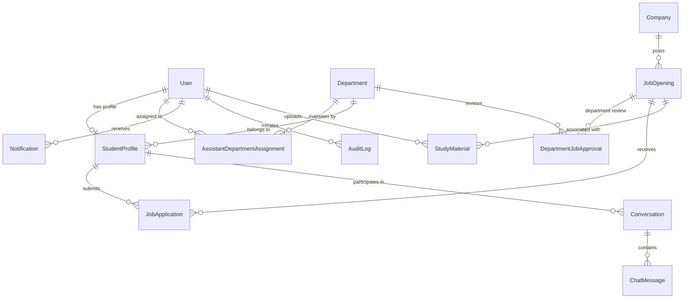

# TPMS — Relational Database Schema Design & ER Specification

This document details the complete relational schema design for the Training and Placement Management System (TPMS).

---

## 1. Entity-Relationship Overview

---

## 2. Table Specifications & Column Definitions

### 2.1 `accounts_user` (Identity & RBAC)
Inherits from Django `AbstractBaseUser` and `PermissionsMixin`.

| Column | Type | Constraints | Description |
| :--- | :--- | :--- | :--- |
| `id` | BIGINT | PRIMARY KEY, AUTO_INCREMENT | Unique identifier |
| `email` | VARCHAR(255) | UNIQUE, NOT NULL, INDEX | Login credential |
| `password` | VARCHAR(255) | NOT NULL | PBKDF2 hashed password |
| `first_name` | VARCHAR(100) | NOT NULL | Given name |
| `last_name` | VARCHAR(100) | NOT NULL | Surname |
| `role` | VARCHAR(30) | NOT NULL, INDEX | Choice: `ADMIN`, `PRINCIPAL`, `TNP_OFFICER`, `TNP_ASSISTANT`, `STUDENT` |
| `phone` | VARCHAR(20) | NULL | Contact mobile number |
| `avatar` | VARCHAR(255) | NULL | Profile image path |
| `is_active` | BOOLEAN | DEFAULT TRUE, NOT NULL | Account status flag |
| `is_staff` | BOOLEAN | DEFAULT FALSE, NOT NULL | Staff flag for Django internals |
| `is_superuser` | BOOLEAN | DEFAULT FALSE, NOT NULL | Superuser flag |
| `last_login` | DATETIME | NULL | Timestamp of last session |
| `date_joined` | DATETIME | NOT NULL | Account creation timestamp |

---

### 2.2 `departments_department` (Academic Disciplines)

| Column | Type | Constraints | Description |
| :--- | :--- | :--- | :--- |
| `id` | BIGINT | PRIMARY KEY, AUTO_INCREMENT | Unique department ID |
| `code` | VARCHAR(20) | UNIQUE, NOT NULL, INDEX | Branch code (e.g. `CSE`, `IT`, `ECE`, `MECH`) |
| `name` | VARCHAR(150) | UNIQUE, NOT NULL | Full department title |
| `description` | TEXT | NULL | Department summary |
| `is_active` | BOOLEAN | DEFAULT TRUE, NOT NULL | Department operational flag |
| `created_at` | DATETIME | NOT NULL | Timestamp created |
| `updated_at` | DATETIME | NOT NULL | Timestamp modified |

---

### 2.3 `departments_assistantdepartmentassignment` (Assistant Scoping)

| Column | Type | Constraints | Description |
| :--- | :--- | :--- | :--- |
| `id` | BIGINT | PRIMARY KEY, AUTO_INCREMENT | Assignment ID |
| `assistant_id` | BIGINT | FOREIGN KEY (`accounts_user.id`), ON DELETE CASCADE | Staff user with role `TNP_ASSISTANT` |
| `department_id` | BIGINT | FOREIGN KEY (`departments_department.id`), ON DELETE CASCADE | Target academic branch |
| `assigned_at` | DATETIME | NOT NULL | Timestamp assigned |
| `assigned_by_id` | BIGINT | FOREIGN KEY (`accounts_user.id`), NULL, ON DELETE SET NULL | Admin who made assignment |

*Index / Unique Constraint*: `UNIQUE(assistant_id, department_id)`

---

### 2.4 `students_studentprofile` (Candidate Academic Vault)

| Column | Type | Constraints | Description |
| :--- | :--- | :--- | :--- |
| `id` | BIGINT | PRIMARY KEY, AUTO_INCREMENT | Profile record ID |
| `user_id` | BIGINT | ONE-TO-ONE (`accounts_user.id`), ON DELETE CASCADE | Linked user account |
| `department_id` | BIGINT | FOREIGN KEY (`departments_department.id`), ON DELETE RESTRICT | Branch of study |
| `roll_number` | VARCHAR(50) | UNIQUE, NOT NULL, INDEX | College roll number (e.g. `21CSE104`) |
| `prn_number` | VARCHAR(50) | UNIQUE, NOT NULL, INDEX | University PRN / Registration ID |
| `gender` | VARCHAR(20) | NOT NULL | `MALE`, `FEMALE`, `OTHER` |
| `date_of_birth` | DATE | NULL | Date of birth |
| `batch_year` | INTEGER | NOT NULL, INDEX | Graduation year (e.g. `2025`) |
| `degree` | VARCHAR(50) | NOT NULL | `B.Tech`, `M.Tech`, `MCA`, `BCA` |
| `tenth_percentage` | DECIMAL(5,2) | NOT NULL, CHECK(0.00 <= val <= 100.00) | Secondary examination score % |
| `twelfth_percentage` | DECIMAL(5,2) | NOT NULL, CHECK(0.00 <= val <= 100.00) | Higher secondary / Diploma score % |
| `graduation_cgpa` | DECIMAL(4,2) | NOT NULL, CHECK(0.00 <= val <= 10.00) | Cumulative Grade Point Average |
| `active_backlogs` | INTEGER | DEFAULT 0, NOT NULL, CHECK(val >= 0) | Current live backlogs count |
| `history_of_backlogs` | INTEGER | DEFAULT 0, NOT NULL, CHECK(val >= 0) | Total cleared backlogs |
| `resume` | VARCHAR(255) | NULL | File path to PDF resume |
| `skills` | TEXT | NULL | Comma-separated technical skills |
| `linkedin_url` | VARCHAR(255) | NULL | LinkedIn profile link |
| `github_url` | VARCHAR(255) | NULL | GitHub profile link |
| `placement_status` | VARCHAR(30) | DEFAULT 'UNPLACED', NOT NULL, INDEX | `UNPLACED`, `PLACED`, `OPTED_OUT` |
| `placed_company_id` | BIGINT | FOREIGN KEY (`companies_company.id`), NULL, ON DELETE SET NULL | Hiring company if placed |
| `salary_package` | DECIMAL(6,2) | NULL | Package in LPA (e.g. 14.50) |
| `created_at` | DATETIME | NOT NULL | Creation timestamp |
| `updated_at` | DATETIME | NOT NULL | Modification timestamp |

---

### 2.5 `companies_company` (Corporate Directory)

| Column | Type | Constraints | Description |
| :--- | :--- | :--- | :--- |
| `id` | BIGINT | PRIMARY KEY, AUTO_INCREMENT | Company ID |
| `name` | VARCHAR(150) | UNIQUE, NOT NULL, INDEX | Company corporate name |
| `website` | VARCHAR(255) | NULL | Official corporate website |
| `industry_sector` | VARCHAR(100) | NOT NULL | `IT / Software`, `Finance`, `Consulting`, `Manufacturing`, etc. |
| `tier` | VARCHAR(30) | DEFAULT 'TIER_2_CORE', NOT NULL | `TIER_1_DREAM`, `TIER_2_CORE`, `TIER_3_MASS` |
| `contact_person` | VARCHAR(100) | NOT NULL | Recruiter / HR POC Name |
| `contact_email` | VARCHAR(255) | NOT NULL | Recruiter official email |
| `contact_phone` | VARCHAR(20) | NULL | Recruiter phone number |
| `address` | TEXT | NULL | Office headquarters address |
| `logo` | VARCHAR(255) | NULL | Corporate brand logo |
| `is_active` | BOOLEAN | DEFAULT TRUE, NOT NULL | Active hiring partner flag |
| `created_at` | DATETIME | NOT NULL | Creation timestamp |
| `updated_at` | DATETIME | NOT NULL | Update timestamp |

---

### 2.6 `placements_jobopening` (Placement Drives)

| Column | Type | Constraints | Description |
| :--- | :--- | :--- | :--- |
| `id` | BIGINT | PRIMARY KEY, AUTO_INCREMENT | Job opening ID |
| `company_id` | BIGINT | FOREIGN KEY (`companies_company.id`), ON DELETE CASCADE | Associated employer |
| `title` | VARCHAR(150) | NOT NULL | Designation (e.g. "Graduate Engineer Trainee") |
| `role_description` | TEXT | NOT NULL | Job description and responsibilities |
| `job_location` | VARCHAR(150) | NOT NULL | Placement city / Remote |
| `package_ctc` | DECIMAL(6,2) | NOT NULL | Compensation in LPA (e.g. 8.50) |
| `bond_details` | VARCHAR(255) | NULL | Bond or retention agreement terms |
| `min_tenth_percentage` | DECIMAL(5,2) | DEFAULT 0.00, NOT NULL | Minimum 10th cut-off % |
| `min_twelfth_percentage`| DECIMAL(5,2) | DEFAULT 0.00, NOT NULL | Minimum 12th cut-off % |
| `min_graduation_cgpa` | DECIMAL(4,2) | DEFAULT 0.00, NOT NULL | Minimum CGPA cut-off |
| `max_active_backlogs` | INTEGER | DEFAULT 0, NOT NULL | Maximum permitted live backlogs |
| `allowed_degrees` | VARCHAR(255) | DEFAULT 'B.Tech', NOT NULL | Comma-delimited degrees |
| `allowed_batches` | VARCHAR(100) | NOT NULL | Comma-delimited target batches |
| `application_deadline` | DATETIME | NOT NULL | Cut-off timestamp for applications |
| `drive_date` | DATE | NOT NULL | Campus drive date |
| `status` | VARCHAR(30) | DEFAULT 'PUBLISHED', NOT NULL, INDEX | `DRAFT`, `PUBLISHED`, `IN_PROGRESS`, `COMPLETED`, `CANCELLED` |
| `created_by_id` | BIGINT | FOREIGN KEY (`accounts_user.id`), NULL, ON DELETE SET NULL | TPO who published |
| `created_at` | DATETIME | NOT NULL | Record creation timestamp |
| `updated_at` | DATETIME | NOT NULL | Record update timestamp |

*Many-to-Many Table*: `placements_jobopening_allowed_departments` (associating `JobOpening` to `Department`).

---

### 2.7 `placements_departmentjobapproval` (Assistant Drive Approval)

| Column | Type | Constraints | Description |
| :--- | :--- | :--- | :--- |
| `id` | BIGINT | PRIMARY KEY, AUTO_INCREMENT | Approval record ID |
| `job_opening_id` | BIGINT | FOREIGN KEY (`placements_jobopening.id`), ON DELETE CASCADE | Target drive |
| `department_id` | BIGINT | FOREIGN KEY (`departments_department.id`), ON DELETE CASCADE | Reviewing department |
| `status` | VARCHAR(30) | DEFAULT 'PENDING', NOT NULL | `PENDING`, `APPROVED`, `REJECTED` |
| `reviewed_by_id` | BIGINT | FOREIGN KEY (`accounts_user.id`), NULL, ON DELETE SET NULL | TnP Assistant who reviewed |
| `comments` | TEXT | NULL | Feedback or rejection justification |
| `reviewed_at` | DATETIME | NULL | Timestamp of review decision |

*Unique Constraint*: `UNIQUE(job_opening_id, department_id)`

---

### 2.8 `applications_jobapplication` (Student Applications)

| Column | Type | Constraints | Description |
| :--- | :--- | :--- | :--- |
| `id` | BIGINT | PRIMARY KEY, AUTO_INCREMENT | Application ID |
| `job_opening_id` | BIGINT | FOREIGN KEY (`placements_jobopening.id`), ON DELETE CASCADE | Target drive |
| `student_id` | BIGINT | FOREIGN KEY (`students_studentprofile.id`), ON DELETE CASCADE | Applying student |
| `applied_at` | DATETIME | NOT NULL | Submission timestamp |
| `verification_status`| VARCHAR(30) | DEFAULT 'PENDING', NOT NULL | `PENDING`, `VERIFIED`, `FLAGGED` |
| `verified_by_id` | BIGINT | FOREIGN KEY (`accounts_user.id`), NULL, ON DELETE SET NULL | Reviewing assistant |
| `verification_notes` | TEXT | NULL | Audit comments |
| `stage` | VARCHAR(30) | DEFAULT 'APPLIED', NOT NULL, INDEX | `APPLIED`, `SHORTLISTED`, `ASSESSMENT`, `TECHNICAL_ROUND`, `HR_ROUND`, `OFFERED`, `REJECTED` |
| `stage_updated_at` | DATETIME | NOT NULL | Timestamp of last round change |
| `remarks` | TEXT | NULL | Recruiter / TPO candidate notes |

*Unique Constraint*: `UNIQUE(job_opening_id, student_id)` (strictly prevents duplicate submissions).

---

### 2.9 `study_materials_studymaterial` (Resource Library)

| Column | Type | Constraints | Description |
| :--- | :--- | :--- | :--- |
| `id` | BIGINT | PRIMARY KEY, AUTO_INCREMENT | Material ID |
| `title` | VARCHAR(200) | NOT NULL | Title of preparation kit |
| `description` | TEXT | NULL | Detailed resource summary |
| `category` | VARCHAR(50) | NOT NULL, INDEX | `APTITUDE`, `TECHNICAL_CODING`, `CORE_ENGINEERING`, `HR_INTERVIEW`, `RESUME_BUILDING` |
| `resource_type` | VARCHAR(30) | NOT NULL | `DOCUMENT_FILE`, `VIDEO_LINK`, `EXTERNAL_URL` |
| `file_attachment` | VARCHAR(255) | NULL | Path to uploaded document/PDF |
| `external_url` | VARCHAR(500) | NULL | Video or web link |
| `department_id` | BIGINT | FOREIGN KEY (`departments_department.id`), NULL, ON DELETE SET NULL | Specific branch or NULL for all |
| `job_opening_id` | BIGINT | FOREIGN KEY (`placements_jobopening.id`), NULL, ON DELETE SET NULL | Drive-specific prep or NULL |
| `uploaded_by_id` | BIGINT | FOREIGN KEY (`accounts_user.id`), NULL, ON DELETE SET NULL | TPO or Assistant creator |
| `created_at` | DATETIME | NOT NULL | Creation timestamp |

---

### 2.10 `notifications_notification` (Alerts Engine)

| Column | Type | Constraints | Description |
| :--- | :--- | :--- | :--- |
| `id` | BIGINT | PRIMARY KEY, AUTO_INCREMENT | Alert ID |
| `recipient_id` | BIGINT | FOREIGN KEY (`accounts_user.id`), NULL, ON DELETE CASCADE | Targeted user (or NULL for role broadcast) |
| `target_role` | VARCHAR(30) | NULL, INDEX | Broadcast to specific role (e.g. `STUDENT`) |
| `title` | VARCHAR(200) | NOT NULL | Brief headline |
| `message` | TEXT | NOT NULL | Alert content body |
| `action_url` | VARCHAR(255) | NULL | Deep link to relevant page |
| `is_read` | BOOLEAN | DEFAULT FALSE, NOT NULL, INDEX | Read status flag for direct recipient |
| `created_at` | DATETIME | NOT NULL, INDEX | Dispatch timestamp |

#### `notifications_notification_read_by` (Broadcast Read Tracking)
Many-to-many relationship tracking which users have dismissed or read role broadcasts (`target_role IS NOT NULL`).

| Column | Type | Constraints | Description |
| :--- | :--- | :--- | :--- |
| `id` | BIGINT | PRIMARY KEY, AUTO_INCREMENT | Junction ID |
| `notification_id` | BIGINT | FOREIGN KEY (`notifications_notification.id`), ON DELETE CASCADE | Broadcast notification |
| `user_id` | BIGINT | FOREIGN KEY (`accounts_user.id`), ON DELETE CASCADE | User who read the broadcast |

---

### 2.11 `audit_auditlog` (Traceability & Compliance)

| Column | Type | Constraints | Description |
| :--- | :--- | :--- | :--- |
| `id` | BIGINT | PRIMARY KEY, AUTO_INCREMENT | Log ID |
| `user_id` | BIGINT | FOREIGN KEY (`accounts_user.id`), NULL, ON DELETE SET NULL | Actor performing operation |
| `action` | VARCHAR(100) | NOT NULL | Action identifier (e.g. `STUDENT_BULK_IMPORT`) |
| `entity_type` | VARCHAR(50) | NOT NULL | Entity modified (e.g. `StudentProfile`, `JobOpening`) |
| `entity_id` | VARCHAR(50) | NULL | Identifier of affected record |
| `details` | TEXT | NULL | JSON or textual description of changes |
| `ip_address` | VARCHAR(50) | NULL | Originating client IP |
| `created_at` | DATETIME | NOT NULL, INDEX | Timestamp of event |

---

### 2.12 `career_assistant_conversation` (Threaded Mentorship Sessions)

| Column | Type | Constraints | Description |
| :--- | :--- | :--- | :--- |
| `id` | BIGINT | PRIMARY KEY, AUTO_INCREMENT | Unique conversation session ID |
| `student_id` | BIGINT | FOREIGN KEY (`students_studentprofile.id`), NOT NULL, ON DELETE CASCADE | Associated student candidate |
| `title` | VARCHAR(255) | NOT NULL | Dynamic topic title (e.g. "Full Stack Preparation") |
| `created_at` | DATETIME | NOT NULL | Session initialization timestamp |
| `updated_at` | DATETIME | NOT NULL, INDEX | Timestamp of latest interaction |

---

### 2.13 `career_assistant_chatmessage` (Conversational Message Stream)

| Column | Type | Constraints | Description |
| :--- | :--- | :--- | :--- |
| `id` | BIGINT | PRIMARY KEY, AUTO_INCREMENT | Unique message ID |
| `conversation_id` | BIGINT | FOREIGN KEY (`career_assistant_conversation.id`), NOT NULL, ON DELETE CASCADE | Thread parent conversation |
| `sender` | VARCHAR(20) | NOT NULL, INDEX | Message origin choice: `STUDENT`, `ASSISTANT` |
| `content` | TEXT | NOT NULL | Raw message payload / rich Markdown content |
| `timestamp` | DATETIME | NOT NULL, INDEX | Dispatch timestamp |
