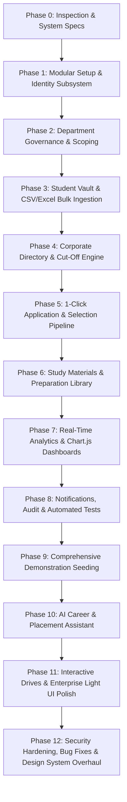

# TPMS — Implementation Roadmap & Execution Plan

This document details the step-by-step phased execution plan for constructing the production-grade Training and Placement Management System (TPMS).

---

## Phase Breakdown & Milestone Objectives

---

### Phase 0: Requirements Analysis & Architecture Documentation
- [x] Extract and analyze the official requirements document (`The Training and Placement Management System.pdf`).
- [x] Formulate architecture, database schema, and security specifications.
- [x] Author comprehensive documentation files in `docs/`.

### Phase 1: Modular Django Infrastructure & Authentication Subsystem
- **Objectives**: Initialize modular Django project, establish custom `accounts.User` model inheriting from `AbstractBaseUser`, configure database settings, and build the custom authentication interface.
- **Key Tasks**:
  - Configure `tpms_project/settings.py` with `AUTH_USER_MODEL = 'accounts.User'`, media directories, and installed apps.
  - Create apps: `accounts`, `core`, `departments`, `students`, `companies`, `placements`, `applications`, `study_materials`, `notifications`, `analytics`, `audit`.
  - Author `accounts.User` model with email login, hashed password, role choices, and phone number.
  - Implement custom login, logout, and role redirection views.
  - Build custom login template and public landing page with modern SaaS typography (Inter) and Linear/Stripe design tokens.
  - Execute initial database migrations.

### Phase 2: Department Governance & Assistant Scoping (`departments`, `accounts`)
- **Objectives**: Implement department master data, staff account provisioning, and multi-tenant assistant department allocation.
- **Key Tasks**:
  - Implement `Department` and `AssistantDepartmentAssignment` models.
  - Build Admin Panel UI: User management table (add/edit/toggle staff), department management table, and assistant assignment modal/views.
  - Implement manual server-side validation functions (no Django Forms).
  - Verify department isolation helper functions.

### Phase 3: Student Academic Vault & Ingestion Pipeline (`students`)
- **Objectives**: Develop student profiles, resume storage, and atomic CSV/Excel bulk ingestion.
- **Key Tasks**:
  - Implement `StudentProfile` model with academic metrics (10th %, 12th %, CGPA, backlogs, batch, PRN, roll number).
  - Implement manual student profile creation and editing views for TnP Assistants (strictly filtered by assigned department).
  - Implement `services/bulk_import.py` utilizing Python `csv` and `openpyxl` with duplicate email/roll number detection, transaction atomicity, and validation reports.
  - Provide downloadable CSV/Excel template files for assistants.

### Phase 4: Corporate Directory, Job Drives & Cut-Off Engine (`companies`, `placements`)
- **Objectives**: Implement company profiles, campus placement drives, and programmatic eligibility evaluations.
- **Key Tasks**:
  - Implement `Company`, `JobOpening`, and `DepartmentJobApproval` models.
  - Build TnP Officer views: Add/edit company, post job opening with cut-off parameters (Min 10th %, 12th %, CGPA, Max Backlogs, Allowed Departments).
  - Build TnP Assistant views: Review and approve/reject job openings for their assigned department.
  - Implement `services/eligibility.py`: High-performance deterministic evaluator comparing student metrics against job cut-offs with clear reason breakdowns.

### Phase 5: Student Portal, 1-Click Apply & Selection Pipeline (`applications`)
- **Objectives**: Deliver student dashboard, eligibility exploration, one-click application, and recruitment round progression.
- **Key Tasks**:
  - Build Student Dashboard: Explore active drives, view live eligibility badges, and submit 1-click applications.
  - Implement `JobApplication` model with unique constraint (`job_opening`, `student`) and interview stage tracking.
  - Implement Assistant application verification workflow (verify marks, inspect documents).
  - Implement TPO / Assistant candidate progression workflow (`Applied` → `Shortlisted` → `Aptitude` → `Technical` → `HR` → `Offered` / `Rejected`).
  - Automatically update `StudentProfile.placement_status = 'PLACED'` upon job offer release.

### Phase 6: Study Materials & Preparation Library (`study_materials`)
- **Objectives**: Build learning asset repository for campus recruitment preparation.
- **Key Tasks**:
  - Implement `StudyMaterial` model supporting PDF uploads, YouTube/video links, and external tutorial URLs.
  - Enable filtering by category (`Aptitude`, `Technical Coding`, `Core Engineering`, `HR Interview`), department, and specific job opening.
  - Deliver responsive resource library view for students with download/streaming links.

### Phase 7: Real-Time Analytics & Chart.js Dashboards (`analytics`)
- **Objectives**: Executive dashboards with live aggregations and responsive visual charts.
- **Key Tasks**:
  - Implement `services/analytics_service.py`: Aggregate placement rates, branch-wise placements, salary percentiles (Min, Avg, Max CTC), and placed vs unplaced counts.
  - Implement Principal, Admin, TPO, and Assistant metric cards and Chart.js canvases (Bar chart for departments, Donut chart for salary tiers, Line chart for hiring velocity).
  - Implement CSV/Excel export for placement rosters and drive results.

### Phase 8: Notifications, Audit & Automated Test Suite (`notifications`, `audit`, `tests/`)
- **Objectives**: Communication alerts, compliance logging, and comprehensive automated test suite.
- **Key Tasks**:
  - Implement in-app notification engine with unread counter.
  - Implement audit logging on critical actions (staff creation, student bulk import, job posting, offer release).
  - Write and execute automated tests using `python manage.py test`:
    - Auth & password hashing tests.
    - Role permission & access control tests.
    - Assistant department isolation tests.
    - Cut-off eligibility engine evaluation tests.
    - CSV/Excel bulk ingestion and duplicate handling tests.

### Phase 9: Demonstration Data Seeding & Final Polish
- **Objectives**: Populate realistic institutional demonstration dataset and verify flawless navigation across all 5 roles.
- **Key Tasks**:
  - Create management command `python manage.py seed_tpms_data` seeding departments (CSE, IT, ECE, MECH), staff accounts, 20+ realistic students, corporate partners (Google, Microsoft, TCS, Infosys, Deloitte), job openings, applications, study materials, and placement offers.
  - Provide one-click demo role switcher or documented credentials for mentor demonstration.

### Phase 10: AI Career & Placement Assistant Subsystem (`career_assistant`)
- **Objectives**: Engineer an intelligent placement mentor delivering personalized roadmaps, skill gap analyses, and interview prep.
- **Key Tasks**:
  - Implement `Conversation` and `ChatMessage` models with student profile foreign keys.
  - Develop `AICareerAssistantService` with Google Gemini integration and robust rule-based fallback.
  - Implement `CareerContextBuilder` assembling student academic standing and active campus drives.
  - Deliver interactive chat UI (`career_assistant.html`) with dual-strategy Markdown rendering (`marked.js` + secure fallback).
  - Add 13 automated tests in `apps/career_assistant/tests.py` (all passing).

### Phase 11: Interactive Drives Navigation & Enterprise Light Theme Refinement
- **Objectives**: Streamline student drive exploration and standardize on a clean, professional enterprise light aesthetic.
- **Key Tasks**:
  - Transform company names and designations on the Student Dashboard into clean clickable links (`.drive-link`) navigating to verified drive details.
  - Strip distracting dark-mode toggles and `[data-theme="dark"]` overrides to maintain a high-contrast Linear/Stripe institutional design.

### Phase 12: Security Hardening, Defect Remediation & Design System Overhaul
- **Objectives**: Remediate critical security vulnerabilities, fix application lifecycle bugs, deploy the Ink Navy & Marigold design system, and expand the test suite.
- **Key Tasks**:
  - **Security**: Fix demo role switcher authorization (POST only), restrict resume downloads behind authenticated view, switch staff activation to POST, and restrict placement analytics to staff.
  - **Bug Fixes**: Add `read_by` to `Notification` for per-user unread tracking of role broadcasts, fix cross-department study material queries, enforce allowed degrees on drives, support re-application after withdrawal, and fix multi-offer salary overwrites.
  - **AI Assistant**: Upgrade career assistant to direct REST API with configurable `GEMINI_MODEL` (`gemini-flash-latest`) and fix duplicate message submission.
  - **Design System**: Deploy Ink Navy (`#0B192C`) and Marigold (`#FF9F43`) design tokens, bundle Bootstrap 5.3, Bootstrap Icons, Chart.js, and font families locally in `static/vendor/` for 100% offline capability.
  - **Verification**: Authored 14 regression tests in `tests/test_fixes.py`, bringing the automated test suite to **77 total tests** (100% passing).
