# Training and Placement Management System (TPMS)
## System Overview & Executive Project Specification

### 1. Project Purpose & Executive Summary
The **Training and Placement Management System (TPMS)** is an enterprise-grade, web-based management platform engineered to digitize, unify, and govern the end-to-end recruitment and training operations for higher educational institutions. 

Recruitment workflows in traditional collegiate environments suffer from fragmented records across departmental spreadsheets, manual verification bottlenecks, delayed communication of job openings, lack of transparent eligibility enforcement, and opaque selection reporting. TPMS resolves these challenges by introducing a centralized, role-isolated architecture connecting five core institutional stakeholders:
1. **System Administrator (ADMIN)**: Central governance of institutional master data, academic departments, and role provisioning.
2. **Institutional Leadership (PRINCIPAL)**: High-level oversight, compliance monitoring, and macro-level placement analytics.
3. **Training & Placement Officer (TNP_OFFICER)**: Corporate relationship management, campus drive planning, multi-department job publishing, and placement operations.
4. **Departmental Placement Assistants (TNP_ASSISTANT)**: Department-scoped candidate onboarding (manual and CSV/Excel bulk ingestion), departmental drive approval, application verification, and localized study resource curation.
5. **Candidates (STUDENT)**: Profile self-service, real-time eligibility computation, one-click job application, selection stage tracking, and access to curated preparation material.

---

### 2. Core Value Propositions & Architectural Pillars

| Pillar | Operational Challenge | TPMS Engineering Solution |
| :--- | :--- | :--- |
| **Department-Level Isolation** | Assistants accidentally tampering with or viewing candidates outside their branch. | Strict multi-tenant-style ORM filtering where `TNP_ASSISTANT` operations are bounded strictly to assigned department IDs. |
| **Automated Cut-Off Engine** | Manual review of hundreds of students against complex 10th/12th/CGPA/backlog criteria. | Server-side programmatic eligibility evaluation that cross-checks candidate academic metrics against job cut-offs with clear pass/fail breakdown. |
| **Interactive Placement Drives** | Scattered job notices and complex navigation to inspect drive criteria. | Streamlined campus drive table with clean clickable company and job links routing directly to verified drive details. |
| **AI Career & Placement Assistant** | Generic advice without regard to student academic standing or active institutional drives. | Personalized AI-powered placement mentorship evaluating real-time student CGPA, skills, backlog status, and institutional hiring trends with rich Markdown formatting. |
| **Bulk Data Ingestion** | Tedious individual manual entry of hundreds of student academic profiles every year. | Robust CSV and Excel (.xlsx) parsers with duplicate email/roll number detection, pre-validation error logs, and transactional rollbacks. |
| **Transparent Selection Pipeline** | Students uncertain about recruitment stages and status updates. | Formal stage progression (`Applied` → `Shortlisted` → `Technical Round` → `HR Round` → `Selected` / `Rejected`) with immediate in-app notifications. |
| **Executive Real-Time Insights** | Manual compilation of placement stats for accreditation (NAAC/NIRF) taking weeks. | Live dynamic dashboards utilizing Chart.js to render branch-wise placement percentages, salary distribution (Min/Avg/Max CTC), and company hiring trends. |
| **Enterprise Light UI Aesthetic** | Distracting theme toggles and poor contrast degrading professional readability. | Unified design system in `static/css/style.css`: ink navy (`#0B192C`) and warm marigold (`#FF9F43`) palette, Schibsted Grotesk and Public Sans typography, accessible status badges, responsive mobile drawer, and local bundling in `static/vendor` for 100% offline functionality. |

---

### 3. Technology Stack & Architectural Constraints

In strict conformance with approved technical requirements:
- **Backend Framework**: Python 3.12+ / Django 4.2+ (LTS)
- **Database**: SQLite (ACID compliant, zero-config relational database for seamless institutional deployment)
- **Frontend Presentation**: Custom HTML5, CSS3, Bootstrap 5.3, Vanilla JavaScript (ES6+), FontAwesome / Bootstrap Icons
- **Data Visualization**: Chart.js (clean, modern responsive canvas rendering)
- **File Parsing & Media Processing**: `openpyxl` (Excel), Python native `csv`, `Pillow` (avatars & company logos)
- **Strict Guidelines**:
  - No Django default admin interface (`django.contrib.admin` disabled/unexposed).
  - No Django Forms or ModelForms; 100% custom HTML forms with manual server-side input sanitation and field-specific validation.
  - No client-side frameworks (No React/Angular/Vue); server-rendered templates ensuring swift load times and clean architectural separation.
  - Zero plain-text credentials; cryptographic password hashing using Django's PBKDF2 with SHA-256 algorithm.

---

### 4. Stakeholder Roles & Access Overview

```
                      +-----------------------------+
                      |         ADMINISTRATOR       |
                      |  - Dept & User Governance   |
                      |  - Assistant Allocation     |
                      +--------------+--------------+
                                     |
             +-----------------------+-----------------------+
             |                                               |
+------------v------------+                     +------------v------------+
|        PRINCIPAL        |                     |       TnP OFFICER       |
|  - Executive Analytics  |                     |  - Corporate Relations  |
|  - System-wide Audits   |                     |  - Job Drive Publishing |
|  - Placement Trends     |                     |  - Global Study Assets  |
+-------------------------+                     +------------+------------+
                                                             |
                                               +-------------v-------------+
                                               |       TnP ASSISTANT       |
                                               | (Scoped to Department)    |
                                               |  - Student Data Ingestion |
                                               |  - Dept Job Approval      |
                                               |  - Candidate Verification |
                                               +-------------+-------------+
                                                             |
                                               +-------------v-------------+
                                               |          STUDENT          |
                                               |  - Profile & Academics    |
                                               |  - 1-Click Application    |
                                               |  - Tracking & Prep Assets |
                                               +---------------------------+
```

---

### 5. Visual Interface & Architecture Gallery

The platform features an enterprise-grade UI engineered for speed, high contrast, and role clarity, captured live from the running system:

#### 5.1 Public Recruitment Portal
The public landing page displays live institutional metrics directly queried from the database.
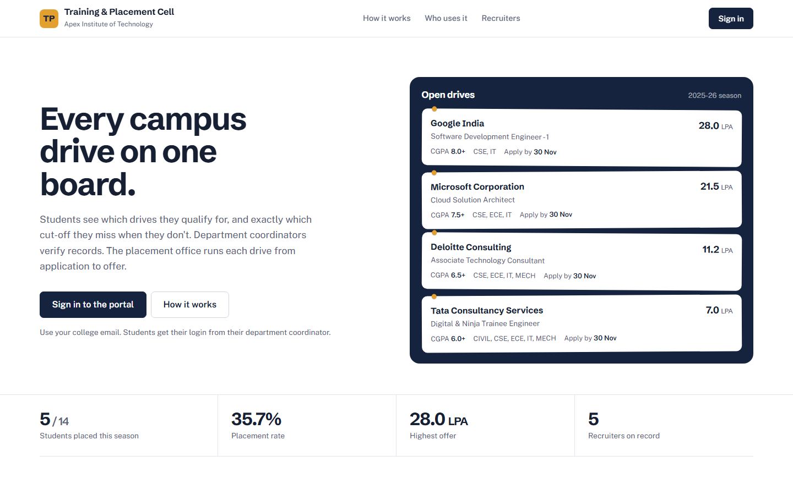

#### 5.2 Role-Based Authentication & Demo Switcher
Clean sign-in interface supporting single-click demo persona authentication when `DEMO_MODE=True`.
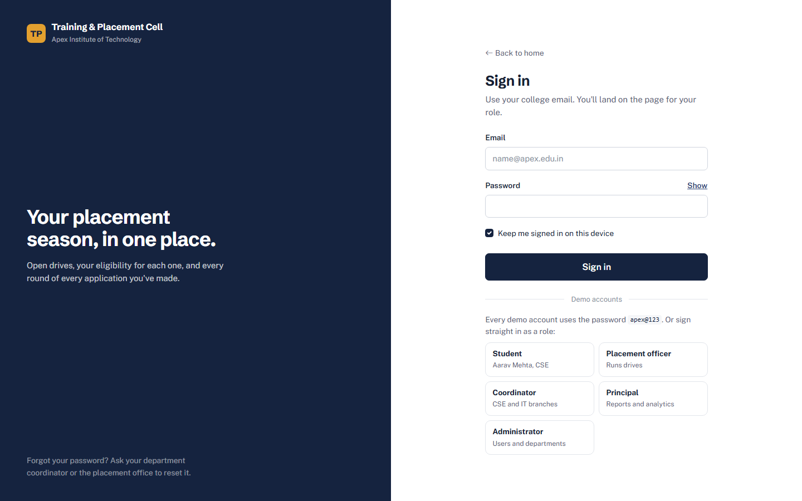

#### 5.3 Student Candidate Dashboard
Personalized student portal displaying ongoing drives, verification status, and active applications.
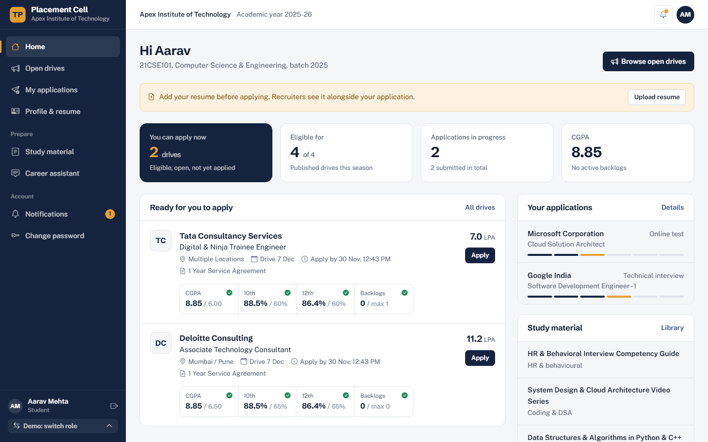

#### 5.4 Student Open Drives & Real-Time Cut-Off Engine
Every campus drive compares candidate academic metrics side-by-side with required cut-offs, highlighting missed criteria in red.
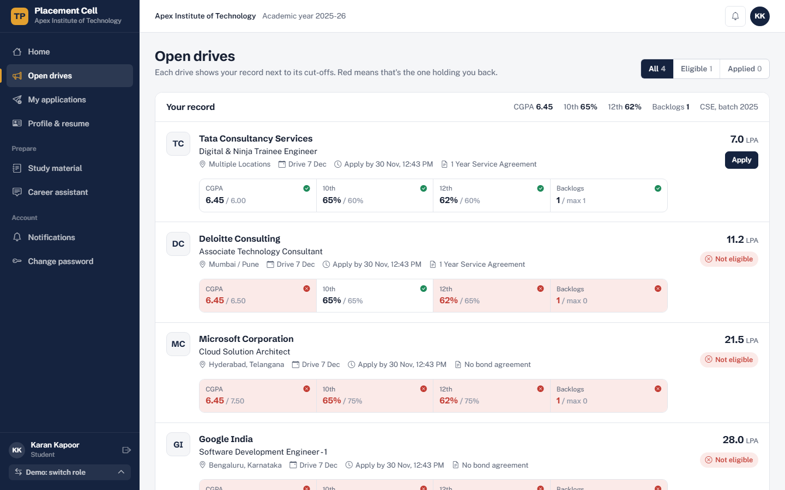

#### 5.5 Candidate Applied Drives Pipeline
Real-time recruitment stage progression tracker across rounds (Applied, Shortlisted, Technical, HR, Offered).
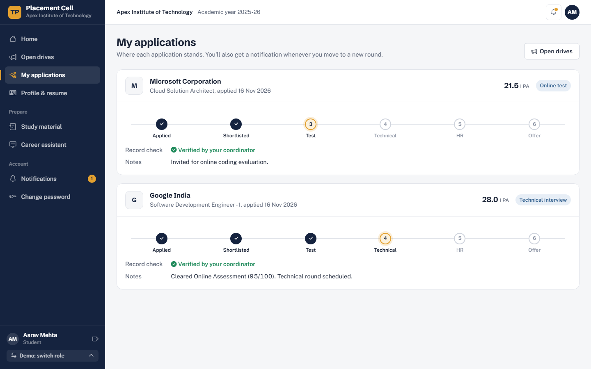

#### 5.6 AI Career & Placement Mentorship Assistant
Conversational guidance interface powered by Gemini with robust local rules-based fallback for student profile analysis.
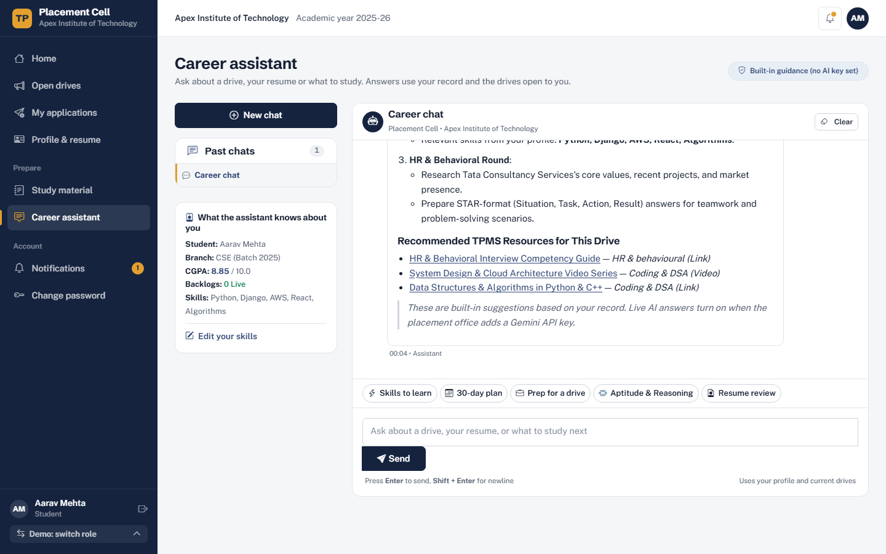

#### 5.7 TPO Operations Command Center
Placement officer overview managing active campus drives, company partnerships, and recruitment rounds.
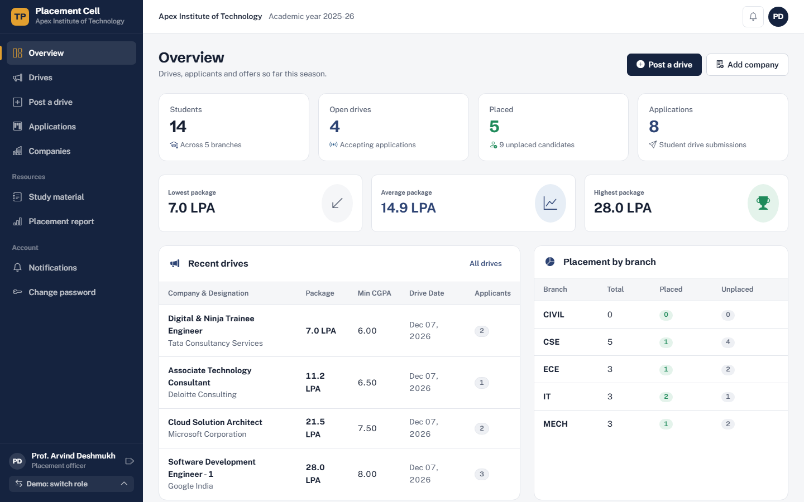

#### 5.8 Drive Detail & Candidate Applications Review
Deep view into individual placement drives, round movements, and applicant rosters.
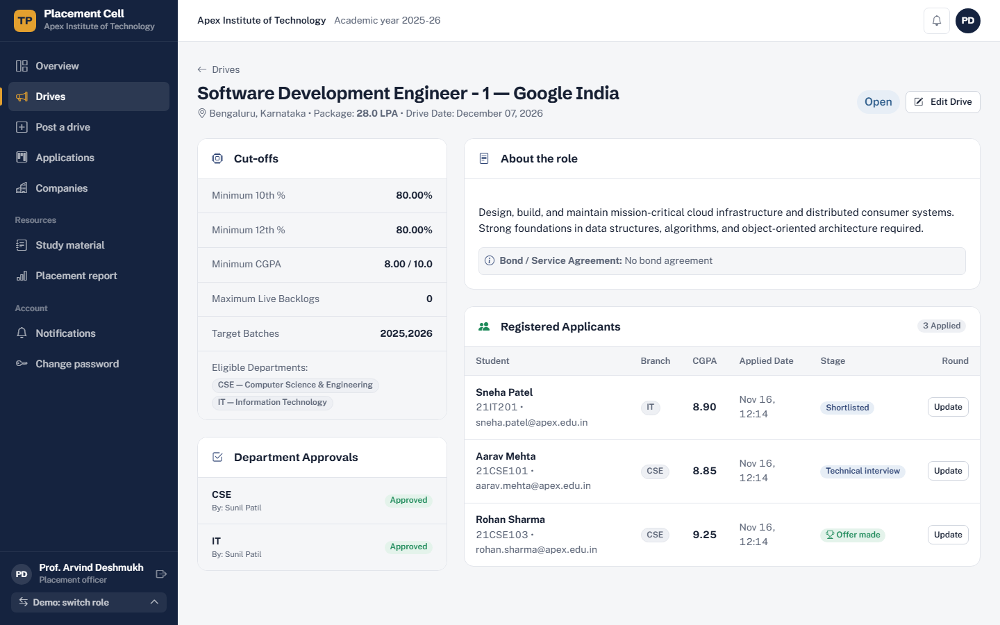

#### 5.9 Executive Placement Analytics (Principal)
Macro-level placement metrics, salary distribution bands (Min/Avg/Max CTC), and branch-wise placement percentages.
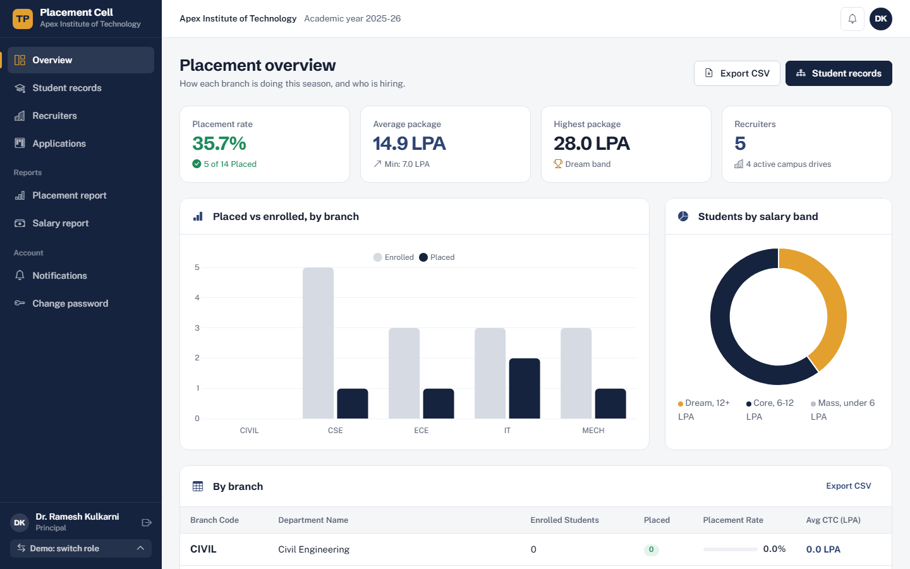

#### 5.10 Department Coordinator Student Roster & Verification
Branch-isolated student academic roster for marks verification and profile auditing.
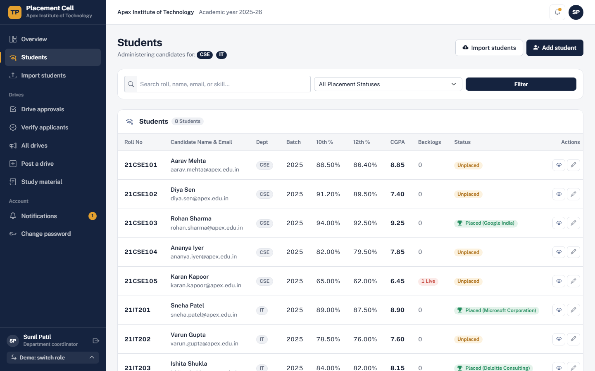

#### 5.11 Administrator Governance & User Provisioning
Central administrative management of user accounts, roles, departments, and coordinator allocations.
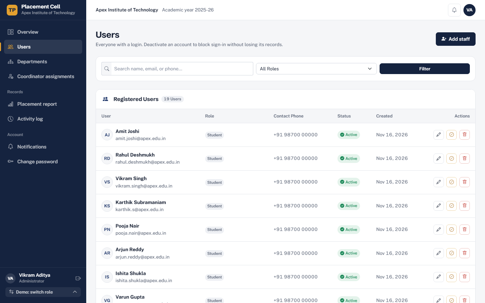

#### 5.12 Responsive Mobile Experience
Optimized mobile interface with sidebar navigation refactored into an accessible off-canvas drawer and reflowing cut-off grids.
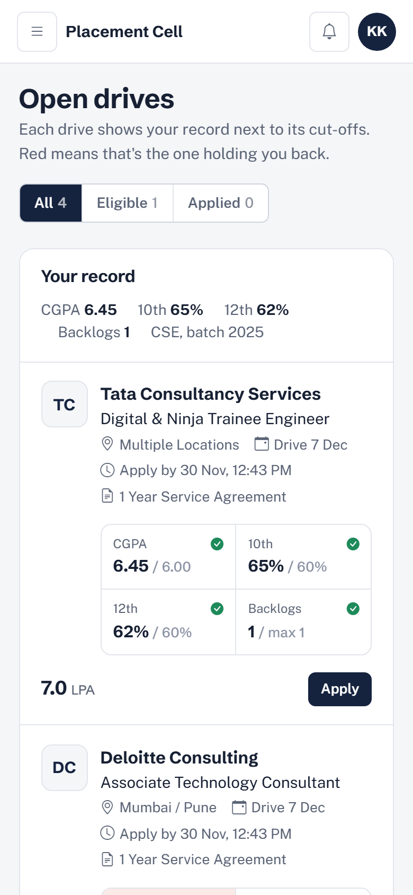

---

### 6. Document Structure
This documentation suite establishes the formal specifications for implementation:
- `PROJECT_OVERVIEW.md`: High-level context, goals, and architectural principles.
- `REQUIREMENTS_BREAKDOWN.md`: Granular decomposition of features, input fields, and business rules.
- `SYSTEM_ARCHITECTURE.md`: Django app organization, view-service-repository patterns, and security layers.
- `DATABASE_DESIGN.md`: Full relational schema, entity relationships, fields, constraints, and indexes.
- `ROLE_PERMISSION_MATRIX.md`: Method-level and view-level authorization rules.
- `IMPLEMENTATION_ROADMAP.md`: Phase-by-phase execution plan from foundation to verification.
- `PROGRESS_REPORT.md`: Real-time milestone tracker and verification checklist.
- `UI_UX_REFINEMENT_REPORT.md`: Granular documentation of interface standards, typography, and accessibility guidelines.
