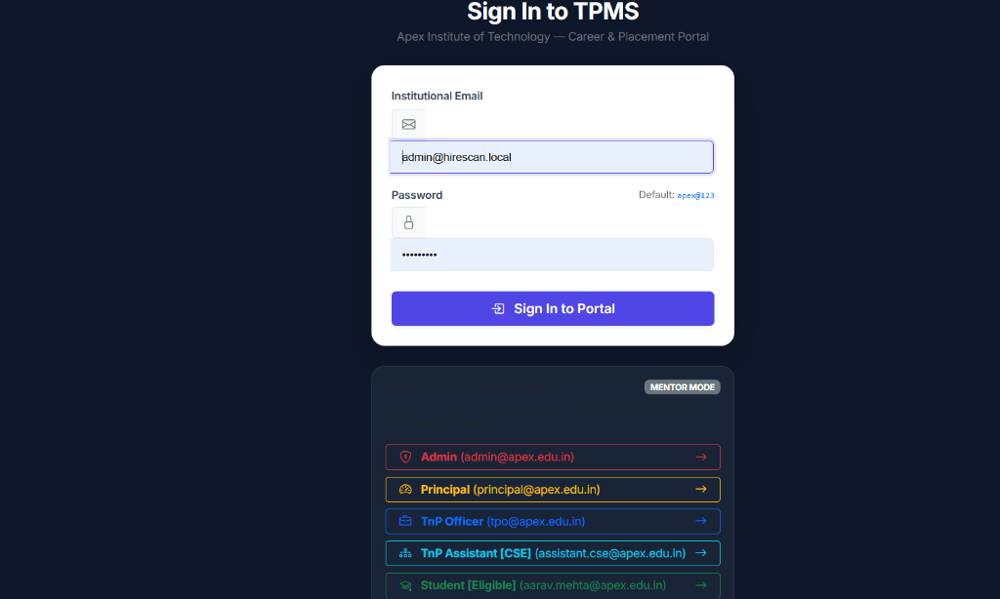
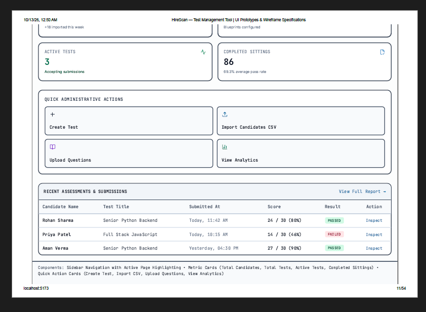

# TPMS — Granular Functional & Non-Functional Requirements Breakdown

This document provides the exhaustive breakdown of all functional modules, field specifications, server-side validation rules, and business logic for the Training and Placement Management System (TPMS).

---

## 1. Public & Core Authentication Module

### 1.1 Public Landing Page
- **Header Navigation**: Institution branding (Apex Institute of Technology), links (`Home`, `About`, `Features`, `Contact`, `Login`).
- **Hero Banner**: "Empowering Careers Through Smarter Placements", subtitle, CTA buttons (`Get Started`, `Explore Drives`, `Portal Login`), live statistic counters (e.g. 94.2% Placement Rate, 180+ Corporate Partners, 45 LPA Highest Package).
- **Core Pillars Section**: Detailed feature breakdown for Students, Corporate Recruiters, and Academic Leadership.
- **Workflow / Process Walkthrough**: Visual 4-step recruitment lifecycle (Student Onboarding → Automated Eligibility Matching → Campus Drives & Interview Rounds → Offer & Onboarding).
- **Recruiter Logos & Testimonials**: Enterprise partner showcase (Google, Microsoft, Infosys, TCS, Amazon, Deloitte).
- **Contact & Footer Section**: Campus contact details, T&P cell inquiry form, quick navigational links.

### 1.2 Authentication & Session Governance
- **Email-Based Login**: Form accepting `email` and `password`.
- **Server-Side Validation**:
  - Email format and non-empty check.
  - Active user check (`is_active == True`).
  - Cryptographic verification via `check_password()`.
  - Redirect dispatcher routing to role dashboard (`ADMIN` -> `/admin-panel/`, `PRINCIPAL` -> `/principal/`, `TNP_OFFICER` -> `/tpo/`, `TNP_ASSISTANT` -> `/assistant/`, `STUDENT` -> `/student/`).
- **Logout & Session Termination**: Invalidation of session token, redirection to landing page with flash confirmation.
- **Access Control Decorators**:
  - `@login_required_custom`: Ensures valid authenticated session.
  - `@role_required(['ADMIN', 'TNP_OFFICER', ...])`: Validates user role.
  - `@department_scoped`: Verifies that `TNP_ASSISTANT` is authorized to access the requested department or candidate record.

---

## 2. Admin Governance Module (`accounts`, `departments`)

### 2.1 User Management
- **Capabilities**: Create, view, edit, toggle active status, and delete staff accounts (`PRINCIPAL`, `TNP_OFFICER`, `TNP_ASSISTANT`).
- **Input Fields**:
  - `first_name` (required, max 50 chars, alphabetic + spaces).
  - `last_name` (required, max 50 chars).
  - `email` (required, valid email, unique).
  - `role` (required, choices: `PRINCIPAL`, `TNP_OFFICER`, `TNP_ASSISTANT`).
  - `phone` (optional, 10-digit format).
  - `password` (required on create, min 8 chars; optional on update).
- **Server Validation**:
  - Uniqueness of email across `accounts_user`.
  - Password strength validation.
  - Protection against self-deletion or deleting the last active Administrator.

### 2.2 Department Management
- **Capabilities**: Create, list, update, and toggle active status of academic branches.
- **Input Fields**:
  - `code` (e.g., `CSE`, `IT`, `ECE`, `MECH`, `CIVIL` - unique, uppercase, 2-10 chars).
  - `name` (e.g., `Computer Science & Engineering` - unique, max 100 chars).
  - `description` (optional text).
  - `is_active` (boolean).
- **Validation**:
  - Prevent deletion of departments with registered students or active placement assignments; allow archival / deactivation instead.

### 2.3 Assistant Department Allocation
- **Capabilities**: Assign one or more departments to a `TNP_ASSISTANT`.
- **Validation**: Enforces 1-to-many or many-to-many link via `AssistantDepartmentAssignment`. Prevents duplicate department assignments for the same assistant.

---

## 3. TnP Assistant Module (`students`, `placements`)

*Strictly scoped to the departments assigned to the currently logged-in Assistant.*

### 3.1 Department Student Roster & Profile Management
- **Single Candidate Add/Edit**:
  - `first_name`, `last_name`, `email`, `phone`, `gender`, `date_of_birth`.
  - `department` (restricted strictly to assistant's assigned departments).
  - `roll_number` (unique, uppercase).
  - `prn_number` (unique institutional registration number).
  - `batch_year` (e.g., 2025, 2026).
  - `degree` (B.Tech, M.Tech, MCA, etc.).
  - `tenth_percentage` (0.00 to 100.00).
  - `twelfth_percentage` (0.00 to 100.00).
  - `graduation_cgpa` (0.00 to 10.00).
  - `active_backlogs` (integer >= 0).
  - `placement_status` (`UNPLACED`, `PLACED`, `OPTED_OUT`).
- **Bulk CSV / Excel Ingestion**:
  - Supported formats: `.csv`, `.xlsx`.
  - Department verification: Ingested rows must belong to the assistant's authorized department(s).
  - Duplicate handling: Detect existing email, roll number, or PRN; provide skip / update options.
  - Transactional integrity: Atomic batch creation; output detailed import summary (e.g. "42 inserted, 3 skipped, 0 failed").
  - Template download: Provide pre-formatted CSV/Excel template with headers.

### 3.2 Departmental Job Approval Workflow
- When a `TNP_OFFICER` publishes a drive targeting multiple departments, the assistant for each department must review and approve/reject the drive for their specific department.
- Statuses: `PENDING_APPROVAL`, `APPROVED`, `REJECTED`.
- Only approved jobs appear on the student dashboard of candidates in that department.

### 3.3 Application Verification
- Assistants review applications submitted by students in their department.
- Ability to verify academic marks against submitted documents, mark as `VERIFIED` or `FLAGGED_DISCREPANCY`.

---

## 4. TnP Officer Module (`companies`, `placements`, `applications`, `study_materials`)

### 4.1 Company Directory
- **Fields**: `name`, `website`, `industry_sector`, `contact_person_name`, `contact_email`, `contact_phone`, `address`, `tier` (`TIER_1_DREAM`, `TIER_2_CORE`, `TIER_3_MASS`), `logo`.
- **Actions**: Add company, edit company, archive company, view past placement drive history.

### 4.2 Placement Drive & Job Opening Engine
- **Fields**:
  - `company` (ForeignKey).
  - `title` (e.g., "Software Development Engineer - 1").
  - `role_description` & `job_location`.
  - `package_ctc` (in LPA, e.g. 14.50).
  - `bond_details` (e.g., "No bond" or "1 year service agreement").
  - **Eligibility Cut-offs**:
    - `min_tenth_percentage` (e.g. 70.0).
    - `min_twelfth_percentage` (e.g. 70.0).
    - `min_graduation_cgpa` (e.g. 7.50).
    - `max_active_backlogs` (e.g. 0).
    - `allowed_departments` (ManyToManyField with Department).
    - `allowed_batches` (e.g., "2025,2026").
  - `application_deadline` (datetime).
  - `drive_date` (date).
  - `status` (`DRAFT`, `PUBLISHED`, `IN_PROGRESS`, `COMPLETED`, `CANCELLED`).

### 4.3 Drive Stage & Selection Tracking
- Manage recruitment pipeline rounds:
  - Round 1: Online Assessment / Aptitude Test.
  - Round 2: Technical Interview.
  - Round 3: HR / Leadership Interview.
  - Round 4: Final Selection & Offer Letter Release.
- Update candidate application status: `APPLIED` → `SHORTLISTED` → `IN_ASSESSMENT` → `INTERVIEW_ROUND` → `OFFERED` / `REJECTED`.
- When marked `OFFERED`, student's `placement_status` automatically updates to `PLACED`, recording company, package, and offer date.

---

## 5. Student Self-Service Module

### 5.1 Profile & Academic Vault
- View personal details and verified academic metrics.
- Upload/update PDF Resume (max 5MB, validated MIME type `application/pdf`).
- List professional skills, LinkedIn profile URL, and GitHub repository URL.

### 5.2 Intelligent Job Opening & Eligibility Explorer
- **Real-Time Eligibility Engine**:
  - The system evaluates the candidate's metrics against every active job opening:
    - 10th % >= Job min 10th %
    - 12th % >= Job min 12th %
    - CGPA >= Job min CGPA
    - Backlogs <= Job max backlogs
    - Department in Job allowed departments
    - Batch in Job allowed batches
  - Visual display:
    - Badge: **Eligible** (Green) vs **Not Eligible** (Red/Gray).
    - If not eligible, clear breakdown modal/card indicating exact criteria failed (e.g., "CGPA 7.10 is below required 7.50").
- **1-Click Application**:
  - For eligible jobs before deadline, single-click application submission with instant confirmation.
  - Duplicate prevention: Candidate cannot apply more than once to the same drive.

### 5.3 Clickable Placement Drive Navigation
- The Student Dashboard displays the "Ongoing Campus Drives & Programmatic Eligibility" table.
- Company names and job designations are styled as high-contrast clickable links (`.drive-link`, `.drive-sublink`) routing directly to the verified drive details page (`/placements/<id>/`).
- Interactive navigation operates seamlessly alongside the independent 1-click Apply/Applied action button.

### 5.4 Application Status Tracker
- Visual progress stepper displaying current recruitment stage (`Applied` → `Shortlisted` → `Technical Interview` → `HR Round` → `Selected`).
- Download submitted application summary and interview schedule notices.

---

## 6. Study Materials & Preparation Library

### 6.1 Resource Management (TPO & Assistant)
- **Fields**:
  - `title`, `description`.
  - `resource_type`: `PDF_DOCUMENT`, `VIDEO_LINK`, `EXTERNAL_URL`, `CODE_REPOSITORY`.
  - `file_upload`: PDF/DOCX (max 20MB).
  - `external_url`: YouTube, Google Drive, or tutorial link.
  - `category`: `APTITUDE`, `TECHNICAL_CODING`, `CORE_ENGINEERING`, `HR_INTERVIEW`, `RESUME_BUILDING`.
  - `target_department`: Optional (Global if null, or specific branch).
  - `target_job`: Optional (general or company-specific preparation kit).
- **Access**:
  - Students can search, filter by category/company, and download/view resources.

---

## 7. Reports, Analytics & Executive Governance (`analytics`, `audit`)

### 7.1 Dashboard Metric Calculations
- **Total Registered Students** (filterable by department and academic batch).
- **Total Active Job Openings** & **Total Corporate Partners**.
- **Placed vs Unplaced Ratio** (percentage and raw counts).
- **Salary Benchmarks**: Minimum CTC, Average CTC, Median CTC, Maximum CTC across the institution and per department.

### 7.2 Interactive Visualizations (Chart.js)
1. **Department-Wise Placement Performance** (Bar Chart): Total students vs Placed students by branch.
2. **Salary Distribution & Tier Spread** (Doughnut Chart): Tier 1 (>12 LPA), Tier 2 (6-12 LPA), Tier 3 (<6 LPA).
3. **Monthly Hiring Velocity** (Line Chart): Offers released over drive months.

### 7.3 Data Export Capabilities
- Export comprehensive placement rosters and company drive reports to CSV and Excel (`.xlsx`).

---

## 8. Non-Functional & Security Requirements

| Category | Specification | Implementation Standard |
| :--- | :--- | :--- |
| **Authentication** | Cryptographic hashing | PBKDF2 with SHA-256 (standard Django security hasher) |
| **CSRF Protection** | Anti-Cross-Site Request Forgery | `` validated on all POST/PUT/DELETE forms |
| **Server-Side Validation** | Strict manual validation | Manual sanitization and validation in service layer; zero unvalidated POST access |
| **File Safety** | MIME & Extension enforcement | Whitelist validation (`.pdf`, `.csv`, `.xlsx`, `.png`, `.jpg`), secure file renaming |
| **Department Scoping** | Multi-tenant isolation | Assistant queries bounded by `department__in=assistant.departments.all()` |
| **SQL Injection** | Parameterized execution | Django ORM abstraction (never raw unsanitized SQL) |

---

## 9. AI Career & Placement Assistant Module (`apps/career_assistant`)

### 9.1 Mentorship Engine & Real-Time Context
- **Personalized Context Assembly (`CareerContextBuilder`)**:
  - Pulls authenticated student's graduation CGPA, active backlog count, 10th and 12th percentages, verified department, and recorded technical skills.
  - Ingests active campus recruitment drives, company hiring criteria, CTC packages, and student application history.
- **Guidance Synthesis (`CareerPromptBuilder` & `AICareerAssistantService`)**:
  - Primary: Google Gemini API (`gemini-1.5-flash`) via server-side execution.
  - Fallback: Deterministic institutional rule-based engine providing actionable advice if offline or without an API key.
  - Generates 30-day study roadmaps, skill gap analyses, technical interview preparation topics, and resume optimization strategies.

### 9.2 Conversational UI & Markdown Standards
- **Dual-Strategy Markdown Renderer**:
  - Primary: `marked.js` + `DOMPurify` via CDN for standards-compliant rendering.
  - Fallback: Zero-dependency `customSafeMarkdownParser()` handling headings, bold/italic, code blocks, tables, blockquotes, and sanitized links.
- **Session Governance**: Threaded conversation model (`Conversation`), real-time typing indicators, quick starter prompt chips, and automatic session titling.

---

## 10. UI/UX Design System & Interface Gallery

The user interface follows the **Linear / Stripe Enterprise Light Theme Design Language**:

### 10.1 UI Design System Standards
- **Palette**: Pure white and subtle off-white backgrounds (`#ffffff`, `#f8fafc`, `#f1f5f9`), slate borders (`#e2e8f0`, `#cbd5e1`), deep slate typography (`#0f172a`, `#334155`, `#64748b`), and indigo brand accents (`#4f46e5`, `#2563eb`).
- **Typography**: Inter / system-ui typography with strict weight hierarchy and high-contrast readability.
- **Zero Dark-Mode Overhead**: Removed all theme-toggling complexity and dark selectors to guarantee institutional clarity, optimal printability, and distraction-free operation.

### 10.2 Screenshots & Visual Highlights

#### Student Portal & Career Guidance Interface

#### Role-Based Authentication Portal

#### Placement Drive Overview & Prototype Layout

