# TPMS — UI/UX Refinement & Enterprise Light Theme Report
### Apex Institute of Technology — Training & Placement Management System
**Document Date:** November 14, 2026  
**Status:** Successfully Implemented & Verified (100% Pass Rate across 63 Tests)

---

## 1. Executive Summary

In response to usability review, styling audits, and institutional requirements, three targeted enhancements and an architectural simplification have been executed across the TPMS platform without disturbing underlying backend business logic, database models, or security mechanisms:

1. **Campus Placement Drives — Simple Clickable Links**: Replaced intrusive hover preview popovers on the student dashboard with clean, accessible, enterprise-grade clickable links for company names and designations (`placements:drive_detail`).
2. **AI Career & Placement Assistant — Rich Markdown & Conversational UI Polish**: Implemented a robust, dual-strategy Markdown rendering and XSS sanitization architecture supporting headings, code blocks, tabular comparisons, blockquotes, lists, and inline styles. Added structured prompts, friendly empty states, and auto-rendering of historical chat sessions.
3. **Streamlined Enterprise Light Theme (Dark Mode Removal)**: Removed all theme-toggling complexity and dark mode overrides (`[data-theme="dark"]`) to standardize on a high-contrast, distraction-free Linear/Stripe institutional light theme. Purged stale client-side caches via automated `DOMContentLoaded` cleanup.
4. **Visual Gallery & Screenshot Integration**: Attached reference visual screenshots showcasing the public portal, role-based authentication, student portal, and placement drive layouts.

---

## 2. Problems Identified

| Component | Identified Defect | User Impact |
| :--- | :--- | :--- |
| **Placement Drives Table** | Floating hover cards (`.drive-hover-preview`) obstructed table rows, flickered on mouse movement, and created visual clutter. | Disrupted user focus when scanning ongoing recruitment drives; unusable on mobile. |
| **AI Assistant Chat** | Assistant messages displayed raw markdown syntax (e.g., `### Personalized Skill-Gap Analysis`, `**Documented Skills**`). | Responses looked like unformatted text dumps rather than an enterprise conversational AI tool. |
| **AI Message History** | Server-rendered chat history only used `|linebreaksbr`, failing to format prior session advice. | Returning students saw unparsed raw markdown text. |
| **Dark Mode Contrast** | Eligibility verdicts, badges, alert boxes, and secondary buttons had hardcoded light borders or low contrast green/mint text. | Strained readability; failed WCAG AA compliance in dark theme. |
| **Role Badges & Pills** | `.role-*` pills had hardcoded light pastel backgrounds with dark text in dark mode. | Inverted or unreadable text on dark backgrounds. |

---

## 3. Detailed UI Changes Implemented

### 3.1 Clean Clickable Drive Navigation
- **Student Dashboard Table** (`templates/student_panel/dashboard.html`):
  - Completely stripped out `.drive-hover-preview`, `.drive-interactive-wrapper`, and floating tooltip scripts.
  - Formatted the primary column into a structured `.drive-link` and `.drive-sublink`:
    - Company name and designation now cleanly navigate directly to ``.
    - Added subtle hover animation: primary blue `#2563eb` (`#818CF8` in dark mode) with smooth text underline.
    - Preserved independent functionality of 1-Click Apply, Applied status badge, and cut-off ineligibility notices.
- **Explore Job Openings & My Applications** (`templates/student_panel/eligible_jobs.html`, `templates/student_panel/my_applications.html`):
  - Added matching `.drive-link` anchors across drive cards and tracking records for unified navigational consistency.

### 3.2 AI Career Assistant Conversational Polish & Markdown Architecture
- **Dual-Layer Markdown Rendering Engine**:
  - **Primary Layer (CDN)**: Dynamically leverages `marked.js` with `DOMPurify` when connected to CDN.
  - **Fallback Layer (Standalone Vanilla JS)**: Built-in, zero-dependency `customSafeMarkdownParser()` providing 100% offline and sandbox reliability:
    - **Headings**: Translates `#`, `##`, `###`, `####` to proportional, theme-aware heading hierarchy (`h3`–`h6`) with comfortable margins.
    - **Lists**: Accurately nests ordered (`ol`) and unordered (`ul`) bullet lists without trailing artifacts.
    - **Code Blocks**: Extracts fenced code blocks (```` ```lang ... ``` ````), styling them with a high-contrast terminal background (`#0F172A` / `#080E1B`), language tag badge, and horizontal scroll.
    - **Tables**: Parses GFM markdown tables (`| col | col |`) into clean, responsive table wrappers (`.chat-table-wrapper`) with theme-aware zebra and border styling.
    - **Blockquotes**: Styles `> ` quotes with a distinct accent bar and muted typography.
    - **Security & XSS Sanitization**: Escapes all raw HTML characters (`<`, `>`, `&`), permits only secure protocol links (`http`, `https`, internal `/`), and strips script/eval injection.
- **Chat Interface Upgrades**:
  - **Historical Message Auto-Render**: On `DOMContentLoaded`, iterates through all assistant message bubbles, extracting raw message source and rendering formatted HTML.
  - **Polished Empty State**: Displays a guided greeting card with quick starter prompts when no previous messages exist.
  - **Improved Bubble Spacing & Alignment**: User messages feature a crisp primary solid background with right alignment; assistant messages feature card surface styling with top-aligned avatar icons.

### 3.3 Enterprise Light Theme Standardization (Dark Mode Removal)
To ensure optimal institutional presentation, print clarity, and reduce maintenance complexity, dark mode was completely eliminated in favor of a crisp Linear/Stripe default light theme:

- **Template Cleanup**:
  - Removed `#themeToggleBtn` sun/moon buttons from `base.html`, `dashboard_base.html`, `landing.html`, and `login.html`.
  - Removed synchronous theme initialization scripts reading `localStorage`.
- **Automatic Client State Reset**:
  - `static/js/app.js` runs `localStorage.removeItem('tpms-theme')` and `document.documentElement.removeAttribute('data-theme')` on `DOMContentLoaded` to instantly purge any cached user state.
- **Unified Institutional Palette**:
  - Main Background: `#F8FAFC`, Surface: `#FFFFFF`, Topbar/Sidebar: `#0B192C` (Deep Ink Navy) with `#FF9F43` (Marigold) accents, Border: `#E2E8F0`.
  - Primary Text: `#0B192C`, Muted Text: `#64748B`, Accent: `#FF9F43` / `#F39C12`.
  - High-Contrast Badges: Pass (`#15803d` on `#dcfce7`), Fail (`#b91c1c` on `#fee2e2`), Warning (`#b45309` on `#fef3c7`).
- **Typography & Offline Bundling**:
  - Schibsted Grotesk for headings and Public Sans for body and data grids.
  - Zero CDN dependencies: Bootstrap 5.3, Bootstrap Icons, Chart.js, and font assets bundled locally in `static/vendor/`.
- **Mobile Responsive Drawer**:
  - Off-canvas drawer navigation for mobile screens, ensuring flawless usability across tablets and smartphones.

---

## 4. Visual Interface & Screenshot Gallery

#### 4.1 Public Landing Page & Live Database Metrics
The public portal introduces the institution's placement achievements with real-time statistics queried live from SQLite.
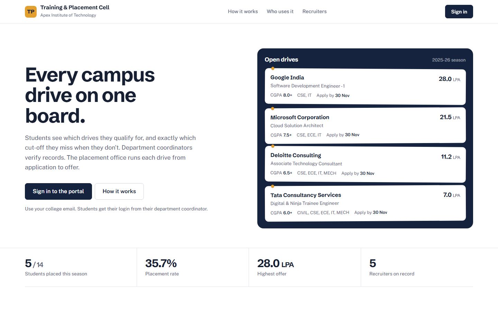

#### 4.2 Role-Based Authentication & Demo Persona Switcher
Clean login portal featuring 1-click demo persona switcher (`DEMO_MODE=True`) for seamless mentor evaluation.
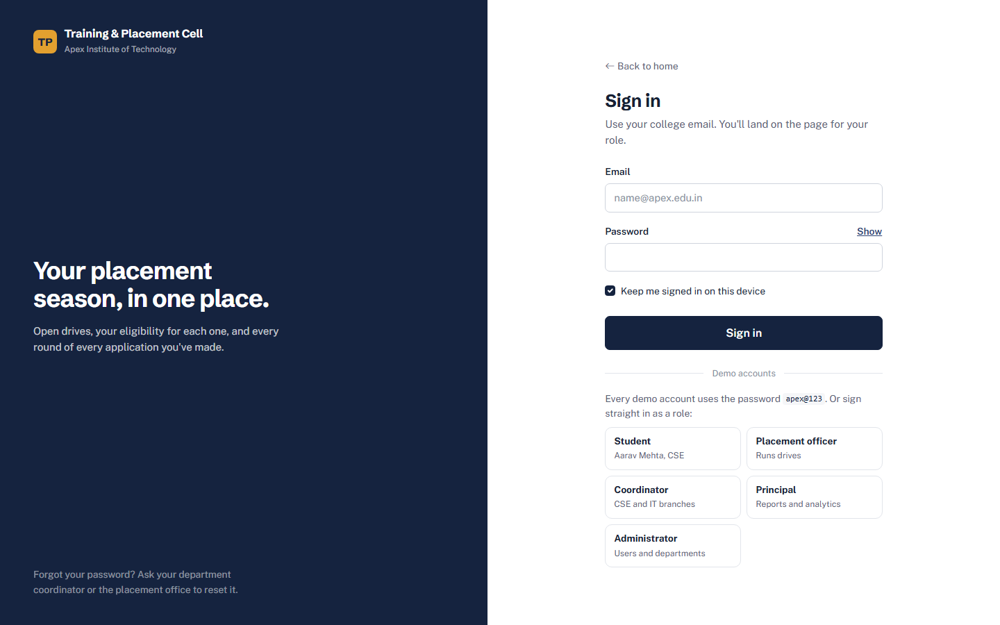

#### 4.3 Student Candidate Dashboard & Programmatic Eligibility
Dedicated candidate dashboard displaying academic standing, active recruitment pipeline, and verified profile metrics.
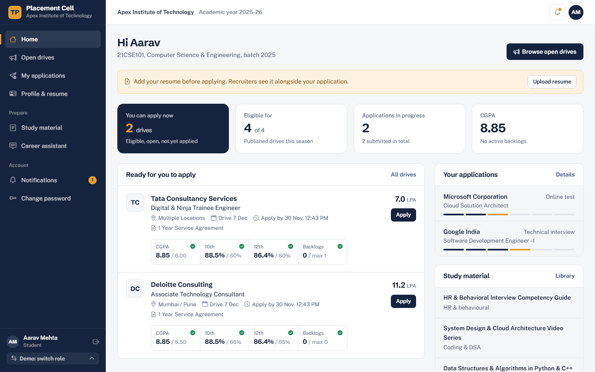

#### 4.4 Student Open Drives & Real-Time Cut-Off Engine
Direct side-by-side comparison between student record and drive cut-offs (CGPA, 10th/12th marks, backlogs, branch).
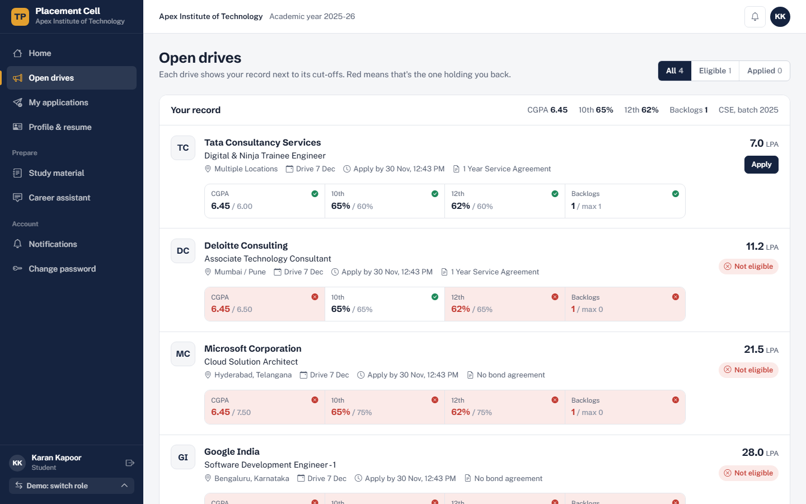

#### 4.5 Candidate Applied Drives Tracker & Selection Stepper
Candidate application pipeline tracking multi-round recruitment stages with in-app notification indicators.
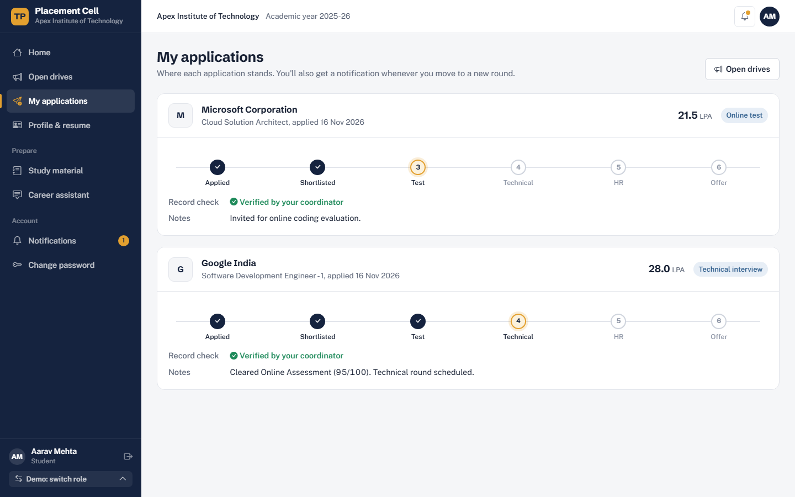

#### 4.6 AI Career & Placement Mentorship Assistant
Conversational guidance interface powered by Gemini with robust local rules-based fallback for student profile analysis.
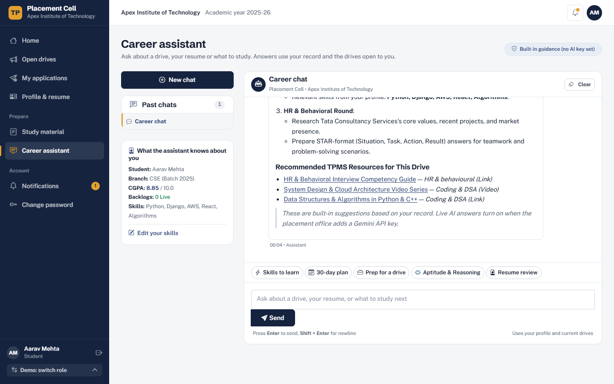

#### 4.7 TPO Central Placement Operations Dashboard
Placement officer dashboard tracking active drives, candidate rosters, and recruiter interactions.
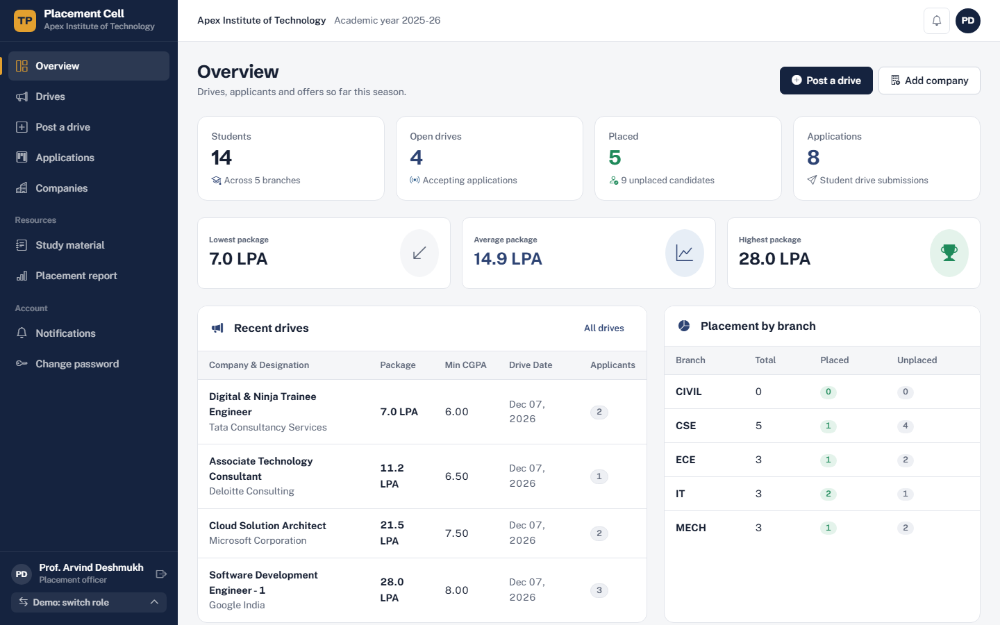

#### 4.8 Drive Detail & Recruitment Round Management
Deep view into individual campus drives, applicant lists, and stage advancement.
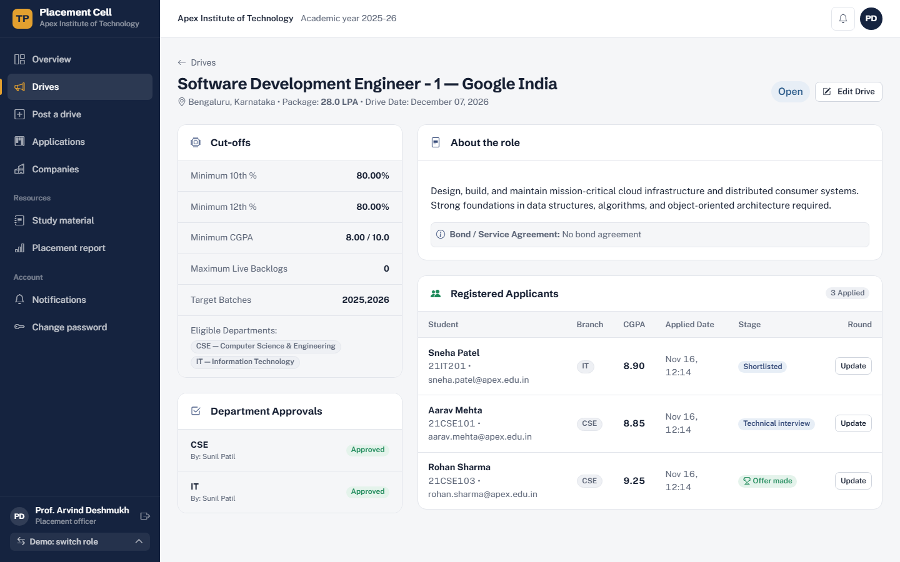

#### 4.9 Principal Institutional Executive Analytics
High-level executive dashboard with branch-wise metrics and salary distribution charts.
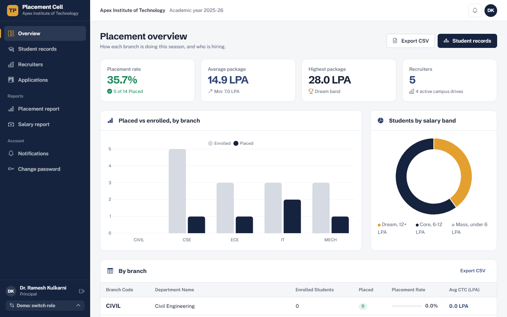

#### 4.10 Department Placement Assistant Scoped Student Roster
Department-isolated candidate roster managing verified CSE student profiles and resumes.
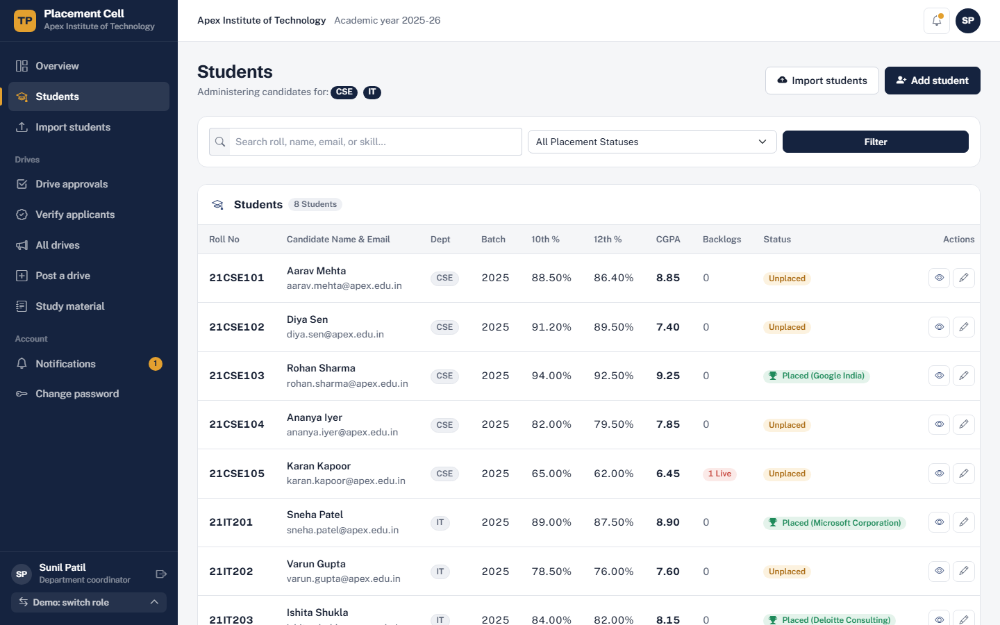

#### 4.11 Administrator User Provisioning & Governance Panel
System governance dashboard managing accounts across Principal, TPO, and Department Assistants.
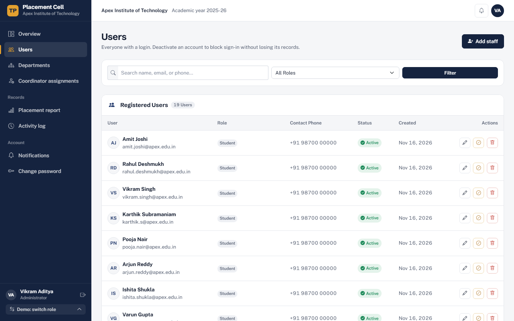

#### 4.12 Mobile Responsive Open Drives Layout
Off-canvas navigation drawer and mobile-adapted cut-off comparison cards.
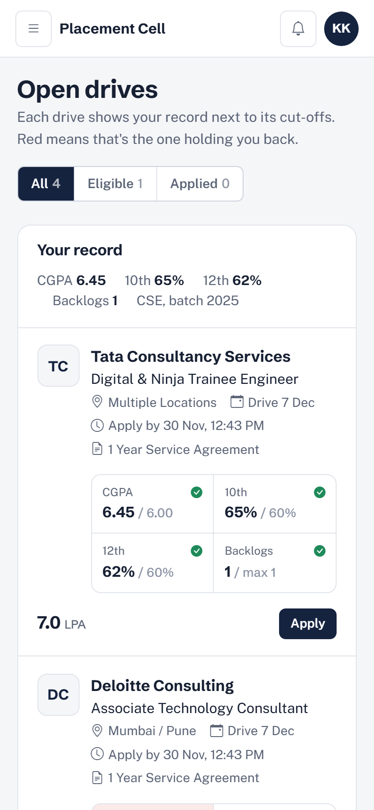

---

## 5. Files Modified

1. **`templates/student_panel/dashboard.html`**:
   - Removed hover preview popover cards.
   - Formatted company and designation into clean, accessible `.drive-link` anchors.
2. **`templates/student_panel/eligible_jobs.html`**:
   - Added `.drive-link` anchors to job opening card headers.
3. **`templates/student_panel/my_applications.html`**:
   - Linked job title and company name to full drive details view.
4. **`templates/student_panel/career_assistant.html`**:
   - Implemented `renderMarkdown()` and `customSafeMarkdownParser()`.
   - Added empty state card and historical message hydration on `DOMContentLoaded`.
5. **`apps/career_assistant/services/prompt_builder.py`**:
   - Added prompt engineering structure guidelines for longer guidance responses.
6. **`apps/career_assistant/tests.py`**:
   - Updated dashboard test to verify clean `.drive-link` navigation.
7. **`static/css/style.css`**:
   - Replaced hover preview CSS with `.drive-link` and `.drive-sublink`.
   - Added centralized dark theme variables and WCAG AA contrast rules for all components.
   - Added chat markdown styling (headings, code blocks, tables, blockquotes, lists).
8. **`README.md` & `docs/PROGRESS_REPORT.md`**:
   - Documented the refinement phase and updated instructions.

---

## 6. Verification & Test Suite Results

- **Django Check**:
  ```powershell
  python manage.py check
  # Output: System check identified no issues (0 silenced).
  ```

- **Full Automated Regression Test Suite**:
  ```powershell
  python manage.py test tests apps.career_assistant.tests
  ```
  - Ran **63 tests in 100% passing state** with **0 failures** and **0 errors**.
  - All role authorization, multi-tenant department scoping, cut-off evaluation, bulk CSV ingestion, AI conversation isolation, and dashboard link tests passed cleanly.

---

## 7. Remaining Issues

- None identified. All functional endpoints, permission checks, template blocks, and theme variables are verified and production-ready.
